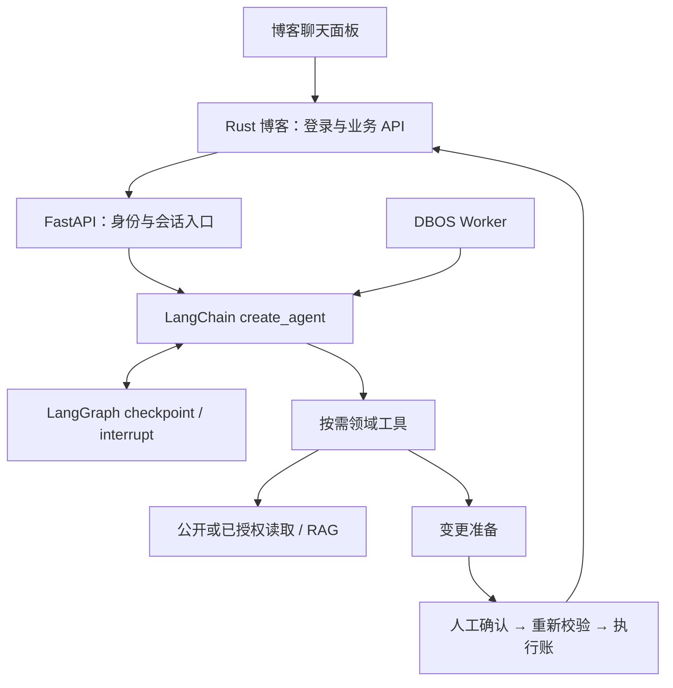

# Saudade Blog Agent

「泠月喵」是运行在真实博客中的内容与管理 Agent，通过自然语言检索文章、参与写作、管理内容和安排后台任务。项目包含聊天组件与服务端执行链路，接入博客的身份、编辑器、业务数据和事务。

模型负责理解目标、选择工具与解释结果；框架和确定性代码负责持久状态、权限、人工确认及执行回执。用户可以在执行中补充要求、暂停任务，并从保存的进度接续。

[在线博客](https://saudade.site/) · [架构](docs/agent-architecture.md) · [部署](docs/deployment.md) · [发布与验收证据](https://github.com/BigLeopardCat/saudade-blog-agent/releases)

在线功能受当前账号权限限制；协作编辑与后台管理需要管理员身份。

## 业务场景

| 场景 | 处理链路 |
| --- | --- |
| 文章问答与比较 | 检索文章 → 获取有版本和章节坐标的正文证据 → 按问题阅读或总结全文 → 返回答案与来源 |
| 协作写作 | 读取当前编辑内容 → 提出正文或标题修改 → 在编辑器审阅采纳；摘要、封面和发布遵循各自的确认流程 |
| 内容管理 | 核实对象与当前状态 → 展示变更预览 → 用户批准 → 后端复核并执行 → 根据真实回执汇报 |
| 图库与 AI 生图 | 选择图库图片或聊天参考图 → 审批模型、提示词和参数 → 后台生成 → 展示结果 → 再次确认是否入库 |
| 后台计划 | 准备提醒、只读报告或受支持的定时写入 → 批准计划 → 到期执行 → 结果回到来源会话 |

后台计划的操作范围、版本约束和授权期限见[调度说明](docs/scheduling.md)。

## 执行架构与工程边界

模型与工具循环使用 **LangChain `create_agent`**；可恢复状态与暂停使用 **LangGraph checkpoint / interrupt**；后台计划使用 **DBOS**。FastAPI 提供 Agent 服务，Rust 博客负责业务 API、身份与事务，PostgreSQL 保存执行状态和向量。



| 工程问题 | 当前实现与边界 |
| --- | --- |
| 多轮、打断与恢复 | 会话记忆、任务执行与 HTTP 连接分别管理；恢复沿用 checkpoint，执行中补充要求在模型调用边界生效。[会话与记忆](docs/conversation-memory.md) |
| 权限与人工确认 | 宿主身份断言、会话所有权和逐次授权；确认绑定用户、会话、具体对象及版本；页面与摘要不能授予权限。[身份与写入](docs/identity-and-permissions.md) |
| 写入失败与重复请求 | 准备和执行分离，执行账保存派发状态及回执；未知结果先核对，不能盲目重放，不承诺跨服务 exactly-once。[执行契约](docs/identity-and-permissions.md#隔离与重试) |
| 上下文、缓存与成本 | 原始对话与模型输入视图区分；按容量压缩、维护工具热工作集、核算完整请求预算，记录真实 usage 与缓存字段。[上下文设计](docs/conversation-memory.md) |
| 检索与证据读取 | BM25S 与可选 pgvector 混合检索、可选本地 embedding；核验公开性、正文版本及章节范围，区分候选、局部证据与全文摘要。[RAG](docs/rag-design.md) |
| 前后端状态一致 | SSE 传递正文与类型化事件；客户端动作等待有界回报，后台结果绑定来源会话。[聊天协议](docs/chat-stream-protocol.md) |

源码入口：[框架执行接线](agent/runtime/execution.py)、[领域执行器登记](agent/domains/registry.py)、[博客产品装配](agent/products/blog/application.py)。新增领域的契约、登记和测试方式见[领域扩展](docs/product-extensions.md)。

## 发布验证

以下为 **v0.3.0，2026-11-16** 的冻结结果：OpenCode / DeepSeek V4.1 Flash，Agent 推理强度 low，248 个文本场景、289 轮请求。

| 指标 | 本轮结果 |
| --- | ---: |
| 确定性检查 | 247 / 248 |
| 综合通过：确定性检查与语义复核 | 244 / 248（98.39%） |
| 核心场景综合通过 | 207 / 210（98.57%） |
| Agent 模型调用 | 626 次 |
| 总输入 / 其中未缓存输入 | 3,559,936 / 1,057,792 token |
| 总输入缓存命中 / 已知稳定前缀复用 | 70.29% / 98.58% |
| 每轮 HTTP 端到端 P50 / P95 | 9.10s / 18.62s |
| 文章阅读首段正文 P95 | 29.91s |

这是固定、低并发文本集的验收数据；两个已知不支持的视觉场景单列排除。HTTP 回归覆盖读取和写入准备，不批准业务写入；浏览器交互、数据库契约和安装恢复另由 [CI](https://github.com/BigLeopardCat/saudade-blog-agent/actions) 验证。综合结果包含 OpenEvals / DeepSeek 初审与逐项 Codex 证据复核，不是独立人工评审或生产成功率的随机抽样。

该批次记录了[总结漏来源](https://github.com/BigLeopardCat/saudade-blog-agent/issues/476)、[统计解读矛盾](https://github.com/BigLeopardCat/saudade-blog-agent/issues/477)、[组合任务误拒绝角色调整](https://github.com/BigLeopardCat/saudade-blog-agent/issues/478)和[文章比较夹入无依据内容](https://github.com/BigLeopardCat/saudade-blog-agent/issues/479)。后续修复的验证记录见各 issue，冻结成绩保留当时的判定。缓存两项指标的分母不同，完整口径、费用、用量和来源指纹见 [v0.3.0 验收附件](https://github.com/BigLeopardCat/saudade-blog-agent/releases/tag/v0.3.0)。

长期可用性和多用户负载仍需持续观察。当前保持 0.x 迭代；发布目标及复现方法见[发布验收](docs/release-acceptance.md)和[评测与观测](docs/eval-observability.md)。

## 开发起步

需要 Python 3.12+ 和 [uv](https://docs.astral.sh/uv/)。默认测试无需模型密钥、博客或数据库。

```sh
git clone https://github.com/BigLeopardCat/saudade-blog-agent.git
cd saudade-blog-agent
uv sync --locked
uv run --frozen pytest -q
cp .env.example .env
```

运行服务前填写模型密钥、与博客一致的 `AGENT_ASSERTION_SECRET`、独立的 `AGENT_CONFIRM_SECRET` 和部署地址；缺少必要凭据时 `/ready` 返回 503。
`BLOG_API_BASE` 同时决定公开工具地址和页面导航的站点来源，部署时必须设为自己的站点。
需要可恢复任务和确认操作时配置独立 PostgreSQL 数据库 `CHECKPOINT_DSN`。
`AGENT_CONTEXT_TOKENS` 应匹配实际模型端点窗口，工作预算及压缩设置见会话文档。

```sh
uv run --frozen uvicorn agent.main:app --host 127.0.0.1 --port 8010
```

`/ready` 检查依赖就绪，`/version` 返回版本信息。聊天入口由[博客宿主](https://github.com/BigLeopardCat/Saudade-Blog)鉴权代理，不应直接暴露内部 Agent 接口。

生产部署使用[首次安装、升级与回滚指南](docs/deployment.md)和[独立运行配置模板](deploy/agent-runtime.env.example)，不从开发工作树启动服务。

一键新装与可选 Docker Compose 由[博客部署入口](https://github.com/BigLeopardCat/Saudade-Blog/tree/cn_sora_blog/deploy)统一编排；本仓的 `Dockerfile` 只负责固定版本 Agent 镜像。两种部署均使用独立 Agent 数据库，不把运行凭据打进镜像。

## 文档

[文档索引](docs/README.md) · [Wiki 教程](https://github.com/BigLeopardCat/saudade-blog-agent/wiki) · [本地起步](docs/getting-started.md) · [配置](docs/configuration.md) · [代码导读](docs/code-reading.md) · [排障](docs/troubleshooting.md)

Wiki 按阅读、确认、写作和后台计划组织教程，[源稿](docs/wiki/Home.md)随 PR 维护。
架构、接口、配置和运维契约保留在仓库，按所用版本查阅；博客安装与站点管理见
[博客文档](https://github.com/BigLeopardCat/Saudade-Blog/blob/cn_sora_blog/docs/README.md)。

## 参与与许可

提交规范及验证入口见 [CONTRIBUTING.md](CONTRIBUTING.md)，计划见 [ROADMAP.md](ROADMAP.md)，安全问题见 [SECURITY.md](SECURITY.md)。

代码按 [MIT](LICENSE) 发布。角色模型、贴图及美术资源使用单独的 [CC BY-NC-SA 4.0 许可](frontend/ASSETS-LICENSE.md)；第三方依赖见 [frontend/THIRD-PARTY.md](frontend/THIRD-PARTY.md)。
