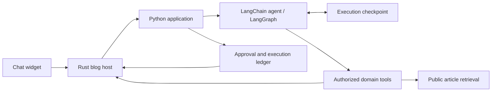

<div align="center">

# Saudade Blog Agent

**English** · [简体中文](README.zh-CN.md)

[](https://github.com/BigLeopardCat/saudade-blog-agent/actions/workflows/eval.yml)
[](https://github.com/BigLeopardCat/saudade-blog-agent/releases/latest)
[](pyproject.toml)
[](LICENSE)

[](https://saudade.site/)
[](docs/en/README.md)
[](docs/en/engineering-cases.md)

</div>

An agent application running inside a live blog. **泠月喵 (Lingyue)** helps readers find and understand articles, assists authors in the editor, and prepares permission-controlled content management operations and scheduled tasks.

The project connects a Python agent service and a chat widget to a separate Rust blog host. LangChain and LangGraph provide the model/tool loop and durable execution primitives; application code implements trusted identity, context and task budgets, source evidence, approval handling, and product integration.

The widget supports English and Chinese interface controls, sharing the blog's language preference without resetting a conversation. Articles and messages retain their original language. The live site reflects its deployed version; content administration and collaborative editing require an authorized account.

## What you can inspect

| Capability | Implementation and evidence |
| --- | --- |
| Article questions and full-document summaries | Versioned public sources, validated passages, and separate full-document coverage checks. [Retrieval and context](docs/en/context-and-retrieval.md) |
| Tool use under application permissions | Identity comes from the host; discovery, invocation, and approved execution each enforce permissions. [Safety and recovery](docs/en/safety-and-recovery.md) |
| Stateful conversations and human approval | Checkpoints, explicit interrupts/resume, and a durable write ledger. [Architecture](docs/en/architecture.md) |
| Bounded execution | Complete-request capacity checks, cumulative task usage, cancellation, and bounded retries. [Context and budgets](docs/en/context-and-retrieval.md) |
| Evaluation and delivery | Offline contracts, disposable PostgreSQL, browser tests, model-task evaluation, and installation/recovery checks. [Evaluation](docs/en/evaluation.md) |



## Start locally

Use Python 3.12+ and uv in an isolated development environment:

```sh
git clone https://github.com/BigLeopardCat/saudade-blog-agent.git
cd saudade-blog-agent
uv sync --locked
uv run --frozen pytest -q tests/test_docs_links.py tests/runtime/test_application_boundaries.py
```

These offline checks do not require a model key or a running blog. A working chat deployment also needs the [blog host](https://github.com/BigLeopardCat/Saudade-Blog), service identity configuration, a model provider, and the state stores required by the enabled features. Follow the [English setup guide](docs/en/getting-started.md); production installation is documented in the [deployment manual (中文)](docs/deployment.md).

Set `AGENT_CONTEXT_TOKENS` to the actual context window of your model endpoint. Input capacity, output reservations, and cumulative task limits have separate roles; see [context and budgets](docs/en/context-and-retrieval.md).

## Read the engineering

Start with [the system boundary](docs/en/architecture.md), then follow [three engineering cases](docs/en/engineering-cases.md): preserving full-document coverage, recovering a write after a lost response, and evaluating answers against actual evidence. Each case links to implementation and regression tests.

The application does not claim arbitrary writes execute exactly once, that a checkpoint keeps a disconnected chat running, or that reading every source character guarantees a faithful summary. Current boundaries and tradeoffs are part of the guides. Release-specific results belong to the [evidence index](eval/release-status.md), rather than a floating README score.

## Documentation and contribution

- **Guides:** [English](docs/en/README.md) · [中文](docs/README.md) · [Wiki tutorials (中文)](https://github.com/BigLeopardCat/saudade-blog-agent/wiki)
- **Engineering:** [Cases](docs/en/engineering-cases.md) · [Code reading (中文)](docs/code-reading.md)
- **Contribute:** [Contribution guide](CONTRIBUTING.md) · [Roadmap](ROADMAP.md) · [Security](SECURITY.md)

English guides explain the core paths; the Chinese reference documents retain detailed operational and protocol contracts. Follow the documentation for the source revision or release you use. English contributions are welcome; the contribution guide describes the shared checks and commit format.

## License

Code is [MIT licensed](LICENSE). Character models, textures, and artwork have a separate [CC BY-NC-SA 4.0 license](frontend/ASSETS-LICENSE.md); see the [third-party notices](frontend/THIRD-PARTY.md) for other assets and dependencies.
