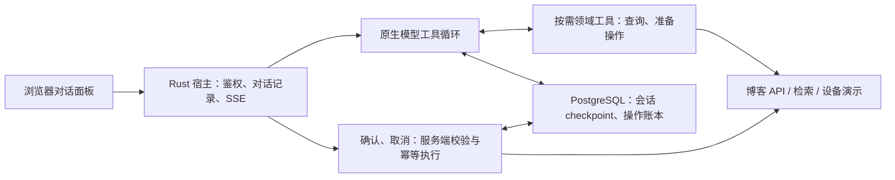

# Saudade Blog AI Agent

博客看板娘“泠月喵”的生产型对话 Agent。项目运行在 FastAPI + LangGraph 上，负责站内内容问答、检索、页面动作、IoT 设备交互、后台管理助手和留言 AI 审核。

项目面向单一业务域，提供确定性执行、权限控制、流式输出和运行时可观测能力。

## 项目定位

当前系统解决的核心问题：

- 模型输出不稳定时，如何仍然按白名单执行；
- 工具失败、返回空结果、服务不可用时，如何区分事实和故障；
- 用户追问、短应答、多轮任务时，如何避免重复执行或编造执行；
- 写操作涉及后台数据时，如何同时做权限校验、目标校验和用户确认；
- 流式连接断开、LLM 超时、并发升高时，如何限制资源和副作用；
- 最终回复如何与真实工具回执保持一致。

## 架构

服务使用唯一的原生工具运行时：模型使用原生工具调用，确定性代码负责授权、确认、
幂等与会话存储。升级部署需将旧 graph/hybrid 配置改为 native；旧规划运行时已从生产依赖中移除。
当前迁移范围和审计结果见 [架构审计](docs/agent-architecture-audit-20261023.md)
与 [迁移验收](docs/hybrid-runtime-migration.md)。



## 关键设计

### 1. 原生工具调用与迁移边界

模型通过标准 tool calls 选择工具并根据工具结果继续完成任务，领域工具按需加载。
工具层负责权限、参数、目标版本和真实业务调用。已确认操作由服务端直接执行，确认轮不再调用模型解释意图。

服务执行路径使用单一原生循环；新增能力进入领域工具层。历史评测解码和少量工具结果
兼容结构仍需继续收敛。

### 2. 工具结果与回复

空结果、目标不存在、服务故障和成功必须可区分，模型只能依据真实工具结果说明执行状态。
旧路径的 `ToolResult` 仍是带属性的字符串子类，序列化容易丢失元数据，属于待替换的兼容结构；
不应扩展为新的通用 IR。目标是标准消息、工具调用参数与结构化业务结果。

### 3. 权限、确认与重试

`Principal` 与 scope 决定身份能做什么；确认记录用户是否同意这一次具体操作。
确认不授予额外权限，执行时仍校验身份、目标和状态。

- 确认令牌绑定用户、会话、有效期与具体操作，采用 HMAC 签名；
- 持久操作标识和账本限制重复写入，重复确认返回已知状态；
- 取消在服务端撤销提议，关闭浏览器卡片不等于取消；
- 确认卡由系统事件产生，模型正文不能制造有效操作凭据。

### 4. 会话状态与上下文

原生运行时在 PostgreSQL checkpoint 中保存会话，宿主提供有限的最近历史与摘要作为补充。
进程内状态不作为跨 worker 的持久真源，删除栅栏阻止迟到请求恢复已删除会话。

浏览器页面数据、待确认操作和历史摘要作为数据消息传入，不进入系统指令。
内部上下文由服务端元数据标识，用户输入类似 `[System: ...]` 的文本仍按用户消息处理。
摘要与模型记忆不是授权依据；身份和权限来自服务端验证的声明。

### 5. 资源与维护边界

工具调用、模型轮次、耗时、输出和历史有明确上限；已确认执行不消耗模型调用。
幂等表与会话存储在启动时初始化，普通写请求不执行建表操作。

小规模单业务应用保留必要的业务授权、幂等和审批逻辑，复用框架公开类型、标准编码库和
既有数据库。遗留工具结果结构与旧事实判定规则继续按领域收敛。

### 6. SSE 帧协议

`POST /chat/stream/v2` 使用标准具名 SSE 事件和 JSON 载荷：正文 `text`、进度
`progress`、确认卡 `confirmation`、浏览器动作 `command`、内部状态 `pending`、
回执 `receipts`、摘要 `summary`，以及终止事件 `done` / `error`。
正文保持不透明；确认凭据和浏览器命令仅从受信任结构化事件处理。
完整三端契约与发布要求见 [流式协议](docs/chat-stream-protocol.md)。

## 启动

```bash
uv sync --locked
uv run --frozen uvicorn agent.main:app --host 127.0.0.1 --port 8010
```

`agent.main.create_app()` 装配路由，生命周期负责运行时和后台工作资源。
导入模块不会连接 checkpoint 或开始预热。已有 `server:app` 命令导出同一个应用，
根目录文件仅保留该 ASGI 导出；路由和评测不再依赖它的内部变量。

## 目录导览

```text
saudade-blog-agent/
├── server.py              同应用 ASGI 导出，兼容已有启动命令
├── agent/
│   ├── main.py            应用工厂与 ASGI 入口
│   ├── api/               HTTP 模型、字段限额和请求上下文适配
│   ├── runtime/           NativeRuntime、会话存储、预算、确认与传输
│   ├── domains/           按需领域工具与业务操作准备
│   ├── authz.py           principal 权限模型与工具 scope
│   ├── principal.py       验证后的调用者身份
│   ├── confirm.py         HMAC 确认令牌
│   ├── transport.py       正文、确认、命令和 receipt 协议
│   └── …                  其余模块见 docs/agent-architecture.md §2
├── tools/                 业务工具注册与共享结果协议
├── rag/                   检索与向量索引
├── eval/                  离线检索评测与契约检查
├── tests/                 离线回归测试
└── docs/                  架构、评测、身份与迁移文档
```

原生按需领域覆盖导航、页面特效、设备显示与查询、内容检索、文章读取、运维和审核报表、后台文章/标签/分类/公告/留言管理、收藏和通知处理、账号管理与闲聊等能力。

## 可靠性边界

系统已经具备以下生产防线：

- NativeRuntime 有界模型循环和请求预算；
- LLM 调用超时、流式空闲超时、总时长上限；
- 线程池和流式并发闸；
- 请求体、字段、历史条数和图片大小限制；
- 客户端断连后的循环级、节点级和逐工具调用检查；
- 服务间身份断言和短时效 JWT；
- 工具返回 `ok / empty / not_found / unavailable` 四态；
- 结构化 trace：运行时事件、分段耗时、回执、受阻原因和结束原因；
- L0 离线单测、L1 检索评测、L2 原生行为契约、L3 跨源对账和夜间自动化。

## 评测

评测分四层（L0–L3），分层口径以 `docs/eval-observability.md` 为准：

```bash
uv sync

# L0 离线、秒级、无 LLM、无网络——整个套件（pytest 按目录收集 tests/）
.venv/bin/python -m pytest -q

# L0 局部（-k 按用例名筛选；修改领域或确认路径后至少跑 native + authz + confirm）
.venv/bin/python -m pytest -q -k 'native or authz or confirm'
# 套件清单**只有"pytest 按目录收集"一处**（`pyproject.toml` 的 `testpaths`）：
# 加套件不用改 CI、不用改夜间脚本、不用改本文——落一个 `tests/test_xxx.py` 上去，下一轮就在跑。

# L0 顺带出一份覆盖率报告：**非门禁、不进 CI**，不设阈值、红了也拦不住任何东西。
# 为什么不做门禁：只有形状判据配当门禁，百分比会把"该测的没测"与"测了但那一支没走到"
# 混成一个数，拿它当闸门只会把人推去测 getter。它回答的是"这轮动得多不多、哪些文件
# 一直没人碰"——是个**给人看的**东西。
bash scripts/dev/coverage.sh

# L1 检索基准（recall@k / MRR，直接测线上 rag/search.py，秒级、无网）
.venv/bin/python eval/recall_eval.py

# L2 真实模型任务评测：需要站点语料、后端和模型凭据；当前暂停线上基线
.venv/bin/python eval/run_golden.py
.venv/bin/python eval/run_golden.py --only <id>,<id>   # 只跑指定用例
.venv/bin/python eval/golden_full_run.py               # 全量跑（与 run_golden 共用判据）

# L2 换成自包含夹具（自带语料、桩服务与用例；出处声明跟着用例文件走）——见 eval/fixtures/README.md
.venv/bin/python eval/fixtures/serve.py --port 8099
BLOG_API_BASE=http://127.0.0.1:8099/api/public \
    .venv/bin/python eval/run_golden.py --golden eval/fixtures/golden_smoke.jsonl

# L3 跨源对账（零 LLM、零网络、只读）：trace ↔ agent.log ↔ 前端上报
.venv/bin/python eval/trace_reconcile.py --days 1

# 产物保留：先审计盘上有没有"没人认领"的产物，再按登记表执行保留期（默认只列不删）
.venv/bin/python eval/retention_manifest.py          # 未登记 0 条 = 每类产物都有主人
.venv/bin/python eval/artifact_retention.py          # dry-run
.venv/bin/python eval/artifact_retention.py --apply  # 真删（夜间脚本已接）
```

几点要知道：

- **L2 的判据锚在维护者的语料上**：`eval/golden/basic.jsonl` 的期望（`require_doc_terms` 的术语表、检索用例的命中目标）是从默认站点那几篇文章的正文里派生的 ⇒ 对着**自己**的博客跑必然对不上，而**红的样子与“模型退化”一模一样**。启动时有一条语料出处闸先判这件事（对不上 ⇒ 全部用例**未评估** + 退出码 3，并明说“这不是模型退化”）；想在自己的部署上跑端到端，用 `eval/fixtures/` 的自包含夹具（自带语料、桩服务与用例，跑法见那里的 README）。
- L0 适合 CI（秒级、无外部依赖），push 即拦截；L2 依赖真实模型和外部服务，不进普通 push 门禁——它由 `scripts/nightly_regression.sh` 在夜间跑，联动 L1 与 L3，任一门禁项失败会在磁盘上留一个标记文件由心跳探针带出来。**这个夜间任务默认是关的**（出厂不装任何 cron；一次全量约 10M tok / ¥2.4，跑的是维护者那台机器上的语料与夹具）——想天天跑就用 `bash scripts/enable_nightly.sh` 打开（默认干跑，`--apply` 才写 crontab），只想看一次读数就直接手跑那个脚本。**没开的时候 `~/agent_regression.failed` 恒不存在 ⇒ 心跳探针那一项恒静默，静默不等于绿。**
- golden 分两类判：带 `regression` 标签的回归组硬判 100%，能力题按通过率。平均数会把两类红混在一起，严重度不同，所以分开。
- 有几条用例需要“真实身份”（要以某个 uid 真调上游），由环境变量给出（见下一节）；未设时它们**响亮地跳过并计入报告**，不静默豁免。
- 设备真实屏显不进入自动化评测；离线验证授权和下发回执。会话历史已有原生读取，
  空置且不可达的知识库占位工具已退役；站内内容继续使用文章检索。

### 产物保留（谁负责清）

盘上每一类产物都在 `eval/retention_manifest.py` 的登记表里有主：登记 `managed`（谁清、留多久）
/ `frozen`（刻意永不删）/ `open`（登记了、暂未接管）。`audit()` 报出没登记的条目——
那就是"缺口"的定义；表里 `managed` 且带 `rule` 的那几类由 `eval/artifact_retention.py`
真的执行（默认只列不删，`--apply` 才动手，已接进夜间脚本）。

保留期与路径**只写在表里这一处**，执行者与夜间脚本都不复述——改保留期改表里的常量即可。
trace 与 golden trace 的保留各有其执行者（`eval/trace_retention.py`、
`eval/golden_trace.py::prune`），表里 `rule=None` 各指一处。

这条规矩的由来：同一形状的问题出现过四次（R2 的保留数、logrotate 的 `rotate 14`、`logs/archive/`、
`eval/report/runs/`），形态都是**「策略写了，但没有任何东西在执行它」**——装饰性配置比没有配置
更坏，因为它看起来是对的。

## 环境变量

配置的取值源**只有一份**：`config/settings.py`（pydantic-settings，读 `.env`）。当前支持的字段列在 [.env.example](.env.example) 里（那个文件是这一份的镜像，两边的分节一一对应）。常用项：

| 变量 | 默认 | 说明 |
|---|---|---|
| `LLM_PROVIDER` | `qwen` | 选 `qwen` / `deepseek` / `openai` / `opencode`，各家的 key/base_url/model 各自独立 |
| `QWEN_API_KEY` / `QWEN_BASE_URL` / `QWEN_MODEL` | — | 每家有同形的三项（`DEEPSEEK_*` / `OPENAI_*` / `OPENCODE_*`），这里以 qwen 为例。**`QWEN_BASE_URL` 自己部署必须显式设**：端点形状（百炼公开端点 / 业务空间专属端点 / 聚合平台地址）见 `.env.example` |
| `LLM_TIMEOUT` | `120` | 单次 LLM 调用超时（秒） |
| `BLOG_API_BASE` | 部署方自己的站点（`.env` 未设时落到代码默认值） | **自己部署必改**：所有只读工具与 RAG 语料的取数地址，导航链接的站点根也由它反推。不改的话工具查的是维护者的博客（接口通、返回真，只是不是你的） |
| `JWT_SECRET` | — | 与 Rust 侧共用，服务间身份断言与短时效 JWT 的签名键 |
| `AGENT_ADMIN_BASE` | `http://127.0.0.1:3000` | 管理读接口的上游地址 |
| `DEVICE_SERVICE_URL` | `http://127.0.0.1:3100` | IoT 设备服务地址 |
| `IOT_ENABLED` | 不设（= 未部署） | IoT 平台是可选件，**不设变量 = 没装**；装了置 `1` |
| `TRACE_DIR` | 部署环境的绝对路径（**自建部署须覆盖**） | 对话 trace 落盘目录。**20260925 起写进 `<TRACE_DIR>/<YYYYMMDD>/`**：枚举由 `utils/trace_files.py` 单点负责（四种读取端共用），保留期由 `eval/trace_retention.py` 执行（>24h 压缩、>30 天删；默认只列不删，`--apply` 才动手） |
| `AGENT_REQUIRE_ASSERTION` | `1` | 缺失/验签失败的身份断言 ⇒ **401**（20261019 起这是默认值，安全审计 SAU-005）。显式置 `0` 才回退信任请求体里的 `user_id`——那条路径上的身份没有角色，工具一件都调不动（`authz.must_enforce`），别留在生产配置里 |
| `AUTHZ_ENFORCE` | `0` | 权限模型的强制开关 |
| `RAG_HYBRID_ENABLED`、`EMBEDDING_*`、`RRF_K` | 不设（= 纯词法） | 向量 + RRF 混合检索，可选件。⚠️ **`EMBEDDING_*` 不只管检索**：首页那件「文章向量空间图谱」的建图（`scripts/build_word_graph.py`）与检索（`rag/wordgraph.py`）也用它——配了走它，没配回落 `QWEN_*` + `qwen3.7-text-embedding`（两端共用 `rag/embed_space.py` 一条规则）。**换模型/端点后要重建一次图谱**（后台「站点设置 → 向量图谱」），否则检索侧以 `space_mismatch` 明着降级 |
| `AGENT_CONTEXT_TOKENS` / `AGENT_REQUEST_TOKENS` | `16384` / `32768` | 完整模型输入加输出预留的上下文上限、单次 HTTP 请求累计 token 上限；缓存 token 也计入。 |
| `AGENT_MODEL_CALLS` / `AGENT_TOOL_CALLS` | `8` / `8` | 请求内的模型调用和工具尝试上限，领域加载也计为工具调用；摘要共用请求预算。 |
| `AGENT_OUTPUT_TOKENS` / `AGENT_SUMMARY_OUTPUT_TOKENS` | `1536` / `512` | 对话和摘要输出上限；回执短叙述使用 192。 |
| `AGENT_MAX_BODY_BYTES` / `AGENT_MAX_CONCURRENT` / `AGENT_MAX_REVIEW` | `12 MiB` / `8` / `4` | 请求体、每 worker 运行请求数、侧任务并发上限。 |
| `AGENT_STREAM_IDLE_TIMEOUT` / `AGENT_STREAM_TOTAL_TIMEOUT` | `120` / `300` 秒 | 流式空闲与请求总截止时间。 |

（20261020 之前这里还有一张 B 表——"`server.py` 直读进程环境的四个常量，`.env` 管不到"。双轨收敛后那张表删了：那四个键连同两个此前改不了的流式超时，都成了上面 A 表的成员，`.env` / systemd `Environment=` / 代码缺省三轨同值。历史见 CHANGELOG 20261020。）

`GOLDEN_ADMIN_UID` / `GOLDEN_USER_UID` 只给 golden 里“需要真身份”的用例用（未设则那些用例响亮跳过）；`TRACE_TOOL_RESULT_LIMIT` 控制 trace 里工具返回留多长（不设 = 按工具分档）；`SAUDADE_IGNORE_ENV_FILE=1` 让**整份 `.env` 不读**（离线套件用，见 `settings.py` 的注）。这三个都是**进程变量，不走 `.env`**。

## 后续维护方向

**状态、触发条件与"明确不做"的清单以 [ROADMAP.md](ROADMAP.md) 为准**（这一节只说方向，
不重复那份表里会变的状态）；每个决定的取舍与当时的替代选项在 [docs/adr/](docs/adr/)。

当前维护重点是收敛运行时与业务接口：

- 完成领域工具迁移，同时删除对应旧技能模板、关键词修正和交接逻辑；
- 将字符串 IR 与 SSE 魔法前缀收敛到明确的结构化边界；
- 先完善工具能力与真实结果评测，再精简提示词；
- 保持 PR 的离线 CI 不依赖维护者服务器、生产凭据或真实模型；
- 用真实任务完成率、token、延迟和缓存指标验证收益。

## 参与

- 想改代码：读 [CONTRIBUTING.md](CONTRIBUTING.md)——本仓最特别的一条规矩是
  **每个行为改动都要带一条能抓住"它其实没生效"的判据**；
- 想知道现在做什么：[ROADMAP.md](ROADMAP.md)（`future` 标签的 issue 是**开着的**，
  不是归档——触发条件写在里面）；
- 发现了安全问题：走 [SECURITY.md](SECURITY.md) 的私密通道，**别开公开 issue**；
- 想知道"为什么会是这样"：[docs/adr/](docs/adr/)。

## 许可

MIT，全文见 [LICENSE](LICENSE)。

`frontend/` 下的**美术资源**（「泠月喵」的模型、贴图、面板图标与形象设计）不在 MIT 的授权
范围内，按 CC BY-NC-SA 4.0 分发，见 [frontend/ASSETS-LICENSE.md](frontend/ASSETS-LICENSE.md)。
角色的**原始 `.psd`**（分层源文件）同属这份协议，作为
[v20261007 发布附件](https://github.com/BigLeopardCat/saudade-blog-agent/releases/tag/v20261007)
分发、不在仓里（那 19 MiB 不该进每个人的 clone 历史）。
