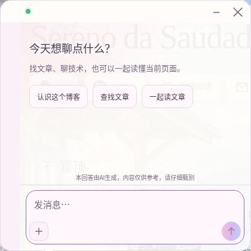

# Saudade Blog Agent

[English](README.md) · **简体中文**

「泠月喵」是运行在真实博客中的内容与管理 Agent，通过自然语言检索文章、参与写作、管理内容和安排后台任务。项目包含聊天组件与服务端执行链路，接入博客的身份、编辑器、业务数据和事务。

模型负责理解目标、选择工具与解释结果；框架和确定性代码负责持久状态、权限、人工确认及执行回执。用户可以在执行中补充要求、暂停任务，并从保存的进度接续。

在线功能受当前账号权限限制；协作编辑与后台管理需要管理员身份。

对话框提供中英文界面切换，与博客共享语言偏好；切换保留草稿、会话和确认状态，文章与聊天正文保留原文。在线站点以实际部署版本为准。

## 界面预览

### 看板娘对话框

从快捷入口认识博客、查找文章或一起读文，也可直接输入问题。登录后可按权限使用写作协作和管理操作，需要确认的写入会先展示方案。

### 博客首页

浏览文章、分类和标签，通过搜索查找内容；左下角的泠月喵提供对话入口。

图片为 [saudade.site](https://saudade.site/) 公开界面的实际截图；界面可切换中英文，文章内容保留原文。更多操作见[使用教程](docs/wiki/Home.md)。

## 使用与开发

- 在配套博客的看板娘中阅读站内文章、比较来源，或由已授权账号准备管理操作。[产品范围](docs/product-scope.md) · [用户教程](docs/wiki/Home.md)
- 从宿主鉴权、模型与工具执行到确认回执，见[架构](docs/agent-architecture.md)。接线与扩展见[代码导读](docs/code-reading.md)和[领域扩展](docs/product-extensions.md)。

## 发布与验收

从 [最新发行版](https://github.com/BigLeopardCat/saudade-blog-agent/releases/latest) 获取 wheel、源码包和锁定依赖。发行说明与 manifest 记录固定提交、配套博客及该版的验证范围。

[发布证据索引](eval/release-status.md)按版本链接冻结的结果和已知限制。HTTP 功能回归覆盖读取、写入准备和权限边界。数据库执行、浏览器交互与恢复由各自的契约检查验证。语义评审用于定位答复质量问题，持续观测见[评测与观测](docs/eval-observability.md)。

## 开发起步

需要 Python 3.12+ 与 uv。在干净检出中执行 `uv sync --locked` 安装依赖，执行 `uv run --frozen pytest -q` 跑离线检查。完整开发环境、宿主接线和就绪核对见[本地起步](docs/getting-started.md)，生产安装走[部署手册](docs/deployment.md)。

接入模型时，将 `AGENT_CONTEXT_TOKENS` 设为当前模型端点的实际上下文窗口。输入、输出和累计预算的关系见[会话与记忆](docs/conversation-memory.md#预算)。

## 文档

- **使用与配置：** [本地起步](docs/getting-started.md) · [Wiki 教程](https://github.com/BigLeopardCat/saudade-blog-agent/wiki) · [配置](docs/configuration.md)
- **开发与排障：** [文档索引](docs/README.md) · [代码导读](docs/code-reading.md) · [排障](docs/troubleshooting.md)
- **英文与案例：** [English guide](docs/en/README.md) · [中文工程案例](docs/engineering-cases.md) · [English cases](docs/en/engineering-cases.md)

Wiki 按阅读、确认、写作和后台计划组织教程，[源稿](docs/wiki/Home.md)随 PR 维护。
架构、接口、配置和运维契约保留在仓库，按所用版本查阅；博客安装与站点管理见
[博客文档](https://github.com/BigLeopardCat/Saudade-Blog/blob/main/docs/README.md)。

## 参与与许可

提交规范及验证入口见 [CONTRIBUTING.md](CONTRIBUTING.md)，计划见 [ROADMAP.md](ROADMAP.md)，安全问题见 [SECURITY.md](SECURITY.md)。

代码按 [MIT](LICENSE) 发布。角色模型、贴图及美术资源使用单独的 [CC BY-NC-SA 4.0 许可](frontend/ASSETS-LICENSE.md)；第三方依赖见 [frontend/THIRD-PARTY.md](frontend/THIRD-PARTY.md)。
