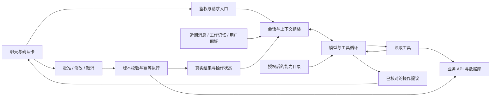

# Agent 架构与记忆审计（2026-10-23）

类型：记录型。本文记录本次审计发现和建议，不表示建议已经实现。

后续已修复原生摘要消费、按预算保留有来源的读取结果，以及摘要水位调度和原子保存。
另已加入原生消息状态预算、框架恢复点裁剪，以及会话删除的持久交付和迟到请求屏障。
原生确认卡另已统一服务端按钮撤销与幂等重取，旧 planner 审批尚未退役。
实现边界见[会话记忆边界](hybrid-runtime-migration.md#会话记忆边界)；本报告各发现保留审计时快照。

## 1. 结论与产品目标

当前系统是过渡实现，尚未达到“像 coding agent 一样理解任务、连续行动、自然交流”的目标。
原生工具循环、服务端鉴权、签名确认、事务写入、幂等账和 PostgreSQL checkpoint 值得保留，
但两套运行时、两套上下文消费规则和旧规划协议仍决定了部分实际行为。
此前“运行时基本完成”的判断需要修正：工具接入比例不是运行时语义统一程度，也不是用户任务成功率。

产品定位应明确为：有稳定人设、能连续对话并完成博客任务的工具型助手。
模型负责理解自然表达、选择工具、组合步骤和回答；程序负责权限、数据契约、资源预算、
必要的操作审批与真实执行。无需实现一个通用编程环境或一套固定业务流程语言。
“听话”体现在理解省略和改口、主动查证、完成授权目标；“活人感”体现在记忆一致、称呼和语气自然、
响应及时，而不是增加口癖、伪造经历或让每个回答都附带追问。

### 关键发现

| 优先级 | 编号 | 发现 | 主要影响 |
| --- | --- | --- | --- |
| P1 | A1 | 原生循环仍可整轮交给旧 planner，未共享任务预算和观察结果 | 简单任务退化成昂贵的受限规划 |
| P1 | M1 | 摘要仍生成，但原生路径不消费；旧路径消费 | 同一会话在两条路径里记忆不一致 |
| P1 | M2 | 原生路径跨轮只保留最近对话散文，没有持久化读取产生的实体引用 | “那篇”“加一个”失去目标依据 |
| P1 | D1 | 已授权能力未被发现时，模型可以直接声称不具备 | 管理员被劝去手动操作、导航意图变读取 |
| P1 | C1 | 旧审批把措辞/当前轮数字作为门槛；两套审批行为并存 | 重复命令后才弹卡，或部分写入走措辞快道 |
| P1 | C2 | 博客先核销确认再转发，重复提交无法进入 Agent 回执重放 | 断网/转发失败后的用户恢复路径不完整 |
| P1 | C3 | widget 的取消按钮只结算本地 UI，未调用服务端撤销 | 用户看到已取消，但提议和授权未同步失效 |
| P2 | I1 | 旧工具调用是 str 子类，持久化后丢失结构属性 | 节点间继续依赖字符串解析和兼容分支 |
| P2 | I2 | 新运行时仍写旧图状态；传输混用字符串前缀和 JSON | 核心逻辑与旧节点、跨语言格式耦合 |
| P2 | M3 | 摘要根据对话散文压缩，缺少事实来源与覆盖水位 | 错误能力描述可以被继续记住 |
| P2 | M4 | 摘要调度依赖当前保留消息条数，更新缺少版本比较 | 达保留上限后可能停更，并发写存在旧摘要覆盖风险 |
| P2 | M5 | 历史、checkpoint、摘要保留窗口不同；删除同步尽力而为 | “删掉/忘掉”与模型实际可见状态可能暂时不一致 |
| P2 | B1 | 预算按字符和固定调用次数，未覆盖 schema 与跨运行时总消耗 | 合理任务过早停止，昂贵任务又能绕到旧路径 |
| P2 | U1 | 原生回答完全缓冲，确认/回执多为固定话术 | 首次可见内容慢，助手像表单机器人 |
| P2 | E1 | 技术回归充分，新的自然多轮任务与记忆验收不足 | 805 项离线通过仍不能防止此次生产失误 |
| P2 | O1 | trace 能算用量，但缺任务级结果与首个可见内容指标 | 便宜的拒绝和昂贵的失败可能被当成正常完成 |

P1 表示先修的核心体验或恢复问题，不等同于本次发现了可利用的权限漏洞。
本文没有把模型能力上限、供应商缓存隔离方式或线上并发竞争推测成已证实根因。

## 2. 审计方法与证据范围

- 检查 Agent 运行时、旧图、计划编解码、消息构造、摘要、checkpoint、确认和幂等代码。
- 检查博客的上下文构造、摘要调度/保存、确认转发和会话删除同步。
- 核对 widget 取消按钮及其通知路径；Agent 当前 widget 源码与博客下载副本相同，树哈希与生产构建 pin 一致。
- 本地 HEAD 为 `305f55d`；生产 Agent 为 `c75ae80`，博客部署为 `42430a3`。
- 生产使用 hybrid、PostgreSQL checkpoint、opencode/deepseek-v4.1-flash，思考模式关闭。
- 统计 2026-10-21 至 2026-10-23 的 56 份 source=production trace，按报告内已登记 trace 排除 30 份已知探针。
  未登记探针无法被完全排除，因此剩余样本不自动称为纯真人流量。
- 当前 `c75ae80` 有 7 份非已知探针样本，以及 8 份已知验收探针；样本量不足以报告稳定的 P95 或全域成功率。
- 做了无模型、无业务写入的复现：摘要哨兵可见性、旧偏好窗口、IR 持久化往返和摘要触发计数。
- 只读核对一个现有 checkpoint：63 条消息、21 个系统上下文壳、12205 字符。没有修改或清空会话。
- 未重跑会写生产数据的旧 Golden 全集，也没有通过更换模型或放宽质量断言掩盖问题。

机器读数保存在本地产物 `eval/report/_smoke_architecture_audit_20261023/`；不将原始私人对话复制进公共仓库。

## 3. Token 与任务成本

以下 input 是所有已记录推理调用的累计输入，包含缓存输入；不是单个上下文窗口大小，也不是账单金额。

| 观察场景 | 模型调用 | 累计 input | cache read | 服务器耗时 | 实际结果 |
| --- | ---: | ---: | ---: | ---: | --- |
| 闲聊“猫儿” | 1 | 3169 | 2048 | 2.9s | 正常回答，但沿用此前错误的导航能力描述 |
| 询问留言分别是谁发的 | 1 | 3267 | 2048 | 3.4s | 未加载管理员领域就声称查不到 |
| 询问能否修改文章标签 | 1 | 3337 | 0 | 4.5s | 描述自身不能直接修改，未形成可执行交互 |
| 查完架构文档后说明标签 | 3 | 14717 | 9856 | 6.3s | 查到文章，但继续要求用户补完整请求 |
| 接着说“加一个测试” | 5 | 175828 | 119808 | 16.9s | 目标解析正确，旧目标闸拒绝，没有弹卡 |
| 重复完整命令后 | 3（含摘要） | 59244 | 54400 | 5.2s | 得到确认卡，尚未执行业务写入 |

后四轮属于同一个改标签交互片段：12 次模型调用、253126 input、1600 output、184064 cache read，
累计服务器处理 32.9 秒。人等待和输入的时间不包含在该耗时里。
这段交互完成的仍只是准备确认，不能算修改成功。

“加一个测试”的成本构成为：原生判断 3318 input，旧 planner 三次合计 158385 input，
叙述节点 14125 input。缓存外输入仍有 56020。旧 planner 每次约 5.3 万输入，是主要成本来源。
只提高缓存命中率不能修复这种退化。

现有原生验收 8 个样本每轮 2–3 次调用、6223–10381 input、2.4–4.3 秒；
这些样本带明确编号和“准备/取消”措辞，不能代表自然连续对话质量。

### 对产品定位的判断

普通闲聊约 3k 输入、一次调用，单看数量不能认定失控；关键还包括缓存、模型速度和可见响应时间。
简单博客操作在反复追问后消耗 59k–176k 输入，明显不符合本产品的复杂度和交互要求。
coding agent 的复杂代码任务可能需要很大上下文，不能拿它为一次加标签的成本辩护。

建议先设以下内部验收预算；它们是本项目目标，不是行业统一标准，也不是供应商性能承诺：

| 任务族 | 模型调用目标 | 累计输入目标 | 说明 |
| --- | --- | --- | --- |
| 普通短对话 | 1 | 通常 1–4k | 记忆按需选取；有长输入时另计 |
| 单个站内读取 | 通常 2，含发现时可为 3 | 通常 4–12k | 查询、答复；返回内容必须与问题相关 |
| 单个变更准备 | 通常 1–3 | 通常 3–12k | 查目标、准备卡片；不要求用户写工具语法 |
| 点击已有确认卡 | 0 | 0 | 直接执行绑定操作；查询/事务的非模型成本另记 |
| 多来源/多步骤任务 | 随任务复杂度增加 | 显式软预算与硬上限 | 允许扩展，不用固定 4 步裁掉合理任务 |

超预算首先分析任务是否完成、是否发生重复查询/错误恢复，不直接删步骤或压缩输出以换指标。

## 4. IR 与节点间通信

### I1：旧 IR 结构没有贯穿持久化边界

`agent/workflow_model.py:31` 的 ToolCall 继承 str，另附 name/args；
实际使用 JsonPlusSerializer 往返后变成普通 str，两个属性均丢失。
`agent/tool_specs.py` 因此继续保留名称切分、JSON/字面量容错解析。

旧顶层 `plan_obj` 已经是计划的事实来源，不能误称为全靠文本计划执行；
但内部工具条目仍混合对象与文本。`plan` 又被渲染给叙述和调试消费，
节点需要理解同一操作的多种表示。`normalize_plan` 还会把含 tools 的待办计划归为 executed，
这表示“产生执行清单”，并不证明真实执行成功，容易误导读 trace 和评测的人。

建议使用标准模型工具调用消息，加少量边界明确的业务类型：工具调用、工具结果、操作提议、操作结果。
跨进程只传普通 JSON 数据；不增加新的全局计划 DSL，不让模型填写执行状态或授权状态。
展示文字是结构化事实的投影，不能被业务代码再解析成指令。

### I2：新循环仍依赖旧图的状态与输出外壳

`agent/runtime/hybrid.py:243` 的 finish 调用旧 `graph_input`，将新轮次写进旧 AgentState。
旧状态有 31 个通道，涵盖计划、反思、纠偏、gate、回执和待确认等内容；
原生路径虽然不需要大部分字段，仍承担其重置和兼容语义。

ToolSession 的读取结果只作为当前 prompt 的 ToolMessage 使用，finish 不保存这段工具对话。
同时 ToolResult 的 kind/data/meta 不作为统一观察结构提供给模型，主要消费字符串正文。
这限制了跨轮引用，也让错误、缺失和成功的数据契约不够一致。

应让会话运行时独立拥有最小状态；业务函数与后端事务继续复用。
工具错误用明确状态和可恢复信息反馈；空列表、不存在、无权限、暂不可用不能混为一种失败。
不要求所有工具返回相同业务 schema，只统一外围状态和标识。

### 传输协议

SSE 本身适合此产品，问题是 payload 混用了 JSON 字符串和 `__CONFIRM__`、`__PENDING__`、
`__EXEC__`、NAVIGATE 等字符串前缀。Python、Rust、前端分别识别其层次，
旧格式和新格式同时存在，升级和调试需要了解多套约定。

逐步改为有版本和事件类型的 JSON envelope，区分正文增量、工具状态、审批提议、执行结果和错误。
会话/轮次、工具调用和操作的标识各有语义，不共享临时字符串作为隐式关联。
旧协议只在传输边界适配；模型生成的正文不解释为控制事件。
无需为此引入消息队列、微服务或通用事件平台。
widget 由博客按源码树 pin 构建，重启 Agent 服务不会更新浏览器代码。
修改交互契约时必须核对服务、博客、widget 三个组件的兼容性和实际部署版本。

## 5. Memory 专项

### 现状地图

| 数据 | 当前来源 | 原生路径行为 | 应有职责 |
| --- | --- | --- | --- |
| 身份与权限 | 当前服务端验签 Principal | 每轮注入 | 即时可信上下文，不是记忆 |
| 当前能力 | 原生领域字典 + 委托工具 + 旧技能表 | 说明分散 | 从同一能力目录派生，权限变化立即生效 |
| 最近对话 | checkpoint messages | 取最近 4 条历史，加当前问题；旧内容各截 600 字尾部 | 保留连续对话，并按任务相关性压缩 |
| 会话摘要 | 博客 chat_summary，Python 独立生成 | 未消费 | 覆盖较早对话，有来源范围和修订水位 |
| 工具观察/目标 | 当前调用返回、旧回执和实体摘要 | 原生读取没有跨轮结构化保留 | 保存可引用目标、必要事实及来源，写前重新核对 |
| 待确认与执行记录 | checkpoint、博客 pending_action/execution_log、幂等账 | 新领域有签名和版本 | 精确业务状态，不能由对话摘要推断 |
| 跨会话用户偏好 | 未发现专用实现 | 不支持稳定跨会话记忆 | 可查看、修正、删除的少量用户明确偏好 |
| 站点知识 | 文章检索/RAG | 可查询 | 文档知识，不冒充个人记忆或执行事实 |

### M1：摘要生成与消费断开，已离线复现

`server.py:798` 把 summary 放入 `[System: ...]` HumanMessage；
`agent/runtime/hybrid.py:61` 的 dialogue 过滤该消息，input 只重建角色、权限、贴纸和页面信息。
用唯一摘要哨兵调用 input，结果不含哨兵；不是摘要质量不好，而是这条路径根本没读到摘要。

摘要在服务器仍可能发起一次模型调用，因此原生路径付出成本却得不到连续记忆。
回旧图时摘要又重新可见。不能用“checkpoint 已持久化”证明这件事已经做好。

### M2：保存了散文，丢失了任务工作记忆

finish 只保存本轮入口消息、最终回复和终止结果，不保存读取中的结构化实体引用。
此前查到文章 19，下一轮“加一个测试”虽然可从散文理解，旧 `_target_evidence` 只接受当前轮工具证据、
页面/用户数字及待办材料，最终报 ungrounded。

简单把全部历史重新塞回 prompt 也不合适。应保留有限的实体引用：资源类型、真实 ID、显示名、
来源调用/消息、查询时间和必要版本；结合最近对话解析指代，执行前重新查证。
同名、多个候选或用户明确换目标时追问，不能把“历史中出现过”当作已授权。

### M3：摘要可能固化错误自我描述

`agent/summarizer.py:66` 的输入是旧摘要、最近 20 条对话和本轮用户消息；它在当前答复前并行启动。
它不能读取本轮真实执行结果。提示词要求总结“系统执行了什么”，依据却主要是历史对话散文。
生产旧摘要中保留过“没有管理员模式”“只能文字/颜文字”等助手错误自述。
摘要器还把所有 user 消息称为“访客”，没有区分当前可信角色；这不能作为身份事实使用。
这不能证明摘要是每次误答的唯一原因，但说明错误会被当作值得保留的对话内容。

摘要应保留用户目标、已澄清的选择、未完成事项及可引用来源，区分用户陈述、工具事实和助手推测。
身份、权限、工具能力和当前业务状态始终读取即时事实，不能从摘要恢复。
本轮结果应在提交后纳入下一次压缩水位，不能凭助手说“完成了”生成成功记忆。

### M4：调度与更新版本

博客 `src/routes/chat.rs:751` 根据当前保留消息数的 `%10 in {0,1}` 决定压缩。
按默认 500 条保留、每轮插入 user 后裁剪、结束再插 assistant 的规则离线模拟，
请求计数为 499、501、502、502、502……；摘要在 501 触发后，后续正常轮次可持续不再触发。
这是一个可达的调度缺陷，不代表当前被审计会话已经达到该上限。

摘要保存还按查询后更新/插入进行，没有比较覆盖水位或摘要 revision。
摘要任务在会话运行锁外并行启动，多请求或重试时存在旧结果覆盖新摘要的风险，本次未在线制造该竞争。

改为依据“新增且尚未覆盖的消息/事件范围”和实际上下文预算压缩，保存 covered-through 标识及 revision。
更新比较版本，失败留待重试；不需要再设计一套摘要规划器。

### M5：生命周期与长期记忆

博客默认保留 500 条显示历史，checkpoint 保存累积消息；检查的会话已有 21 个上下文壳。
项目已有 30 天不活跃线程与幂等账清理，不能称为没有保留治理；但活跃线程仍持续增长，缺少会话内压缩。
删除/丢弃同步已有验签钩子，失败只记录告警。需要可重试、可核对的最终删除状态，不能把聊天记录消失等同于所有记忆已删除。

跨会话记忆从少量用户明确偏好开始，例如称呼、回答语言和交流偏好。
使用现有 PostgreSQL 或现有框架 Store，按账号命名空间保存来源和修订；访客不共享个人记忆。
不需要先建设向量记忆平台，不自动收集每次闲聊，不把操作授权长期记住。

### 建议记忆边界

1. 原始对话/事件负责可追溯历史；checkpoint 负责可恢复运行状态，二者不是长期个人记忆。
2. 工作记忆保存当前目标、解析过的实体和必要观察，按任务/会话管理，不承担规则路由。
3. 会话压缩覆盖较早内容，保留来源水位，与最近完整消息组成一致上下文。
4. 用户偏好跨会话按需召回，允许查看、更正、删除；权限和实时事实不进入这层。
5. 确认提议、取消与执行结果由业务状态机和回执负责，不由 LLM 摘要负责。

LangGraph 官方也区分线程级 checkpoint 短期记忆和跨线程 Store 长期记忆。
本项目应复用这些基本边界，避免把“数据库里有聊天记录”误当成完整 memory。

## 6. 运行时、工具发现与确认

### A1 / D1：原生循环仍缺完整的能力发现

当前管理员入口约 18 个工具定义，其中 13 个领域加载器；原生初始 schema 5860 字符，系统正文约 1098 字符。
这比旧管理员 52 个工具 schema、82520 字符，加 4899 字符 slim 技能上下文已经小很多。
但加载器都叫 info_tools，部分领域已含写入准备；未迁移能力只由一个宽泛 delegate 描述提供入口。
工具定义、能力说明和权限信息来自多处，模型可以不查目录就否认能力。

应从一个能力注册源派生描述、授权可见性和实际工具集合，包含仍经业务适配器执行的能力。
普通模型循环直接使用业务工具；未迁移的底层函数可适配，避免整轮重启旧 planner。
工具名称、描述和返回契约要清楚，但不通过新增能力否认关键词表或回答后正则纠偏来解决。

### B1：预算不等于固定步数

ToolSession 最多 4 次实际工具调用、5 次模型调用；加载器消耗模型轮次但不消耗读取计数。
固定限制对跨领域任务可能过紧，却不约束整轮移交后的旧 planner 消耗。
24000 字符检查只统计 message content，没有把工具 schema 计入上下文预算，且字符不是 token。
部分异常、初始超限或空响应会交旧图；有预算停止也有昂贵回退，两种行为没有统一成本语义。

统一任务级预算覆盖发现、工具读取、主模型、摘要及兼容调用，记录估算与实测，超限可说明并暂停。
根据任务价值允许有限扩展，读取可在独立时采用有界并发；写入仍受明确审批和业务事务控制。
不要再建立复杂固定流程来“节约模型思考”。

### C1：审批应与语言解析分开

新领域的准备→签名→版本校验→幂等执行方向正确；旧路径仍包含命令式措辞快道、疑问句判断、
动作词检查和当前轮目标地基，直接导致此次自然接续失败。
对话能解析清楚的请求直接查证并准备提议；真正缺少目标/操作参数才澄清。
卡片从同一份规范操作展示对象、变更前后和影响，批准执行这份操作；修改参数就更新提议并使旧批准失效。
敏感操作审批与“你是否想让我帮你”不叠加。

### C2：用户侧恢复没有贯穿幂等链路

博客在转发前认领 pending_action.claimed_at，已认领的重复请求直接 409；
Agent 内部虽能重放已有幂等回执，前面的 409 会让重复提交到不了它。
这阻止了双击，但不能向用户区分“已经完成”“还在执行”“转发前失败”“结果未知”。

将批准请求绑定稳定 operation ID，重复提交返回同一操作的状态或已有结果；
网络不确定时查询状态，不重新生成计划或重复业务写入。
授权一次性与请求可重试是两个要求，应同时满足。这里不是承诺跨服务副作用天然 exactly-once。

### C3：取消按钮与服务端撤销没有接通

`frontend/public/live2d-widgets/chat-stream.js:2395` 的 no 分支只调用 askSettle 并返回。
askSettle 清本地存档和按钮、上报 confirm_flow 遥测，没有调用原生 PendingOperation 的撤销逻辑。
因此自然语言“取消”与点卡片“取消”不是同一种操作；后者没有同步撤销服务端提议。
遥测上报不是取消授权。没有在线点击真实业务卡片或尝试消费取消后的令牌来制造副作用。

取消应成为按 operation ID 调用的服务端命令，不经过 LLM；服务端与批准执行竞争同一操作状态。
前端仅在服务端确认撤销后显示已取消，超时显示未确认，并允许查询/安全重试。
两类取消入口共用相同状态机，补上真实浏览器→博客→Agent 的验收。

## 7. 交互、可维护性与评测

### U1：活人感依赖连贯与响应，不只依赖人设文本

当前原生模型 streaming=False，最终答复缓冲后一次输出，trace 也没有真正首 token 指标。
迁移后确认和回执由确定性代码直接返回，保护了事实，但所有任务统一话术会显得机械。

保留固定、可信的操作事实卡片；对话表达与卡片数据分开。
支持真实正文增量和少量真实进度事件，不伪造“正在查”或已完成状态。
自然表达可以带人设，重要的是接住上文、称呼一致、能纠正自己的误解，避免每轮都介绍能力和追问“要不要”。

### 模块边界

当前 graph 9429 行/141 个顶层定义，server 2768 行/61 个定义，authz 1871 行。
原生 hybrid 265 行、session 230 行，本身相对小；不应把全仓规模全部算成新循环的问题。
后续按模型会话、上下文/记忆、工具注册、审批执行和传输拆职责，旧图随着调用者迁走删除。
不只是把函数换文件后继续共享旧巨型状态。

原生代码反向导入旧 graph_input、工具描述多处维护、生产 hybrid 与项目默认 graph 不一致，
均应纳入退役检查；默认切换在行为验收和兼容升级完成后进行。
避免引入新的通用工作流引擎、个人记忆向量平台或额外数据库。

### E1：验收口径需要回到用户任务

已有 805 项离线回归、鉴权/版本/回放测试和 CI 是有价值的基础。
基础 Golden 有 193 个用例，29 个带预置历史、12 个带 rounds；不能说完全没有多轮评测。
但专门 hybrid 请求集仅 6 个用例，无预置历史或连续 rounds，不能覆盖这次场景。
基础集 130 条带工具/流程相关断言，部分是必要执行证据，不能全删；与用户目标无关的固定内部路径要求应退役。

保留确定性权限、参数、取消、回放、事务测试；新增小而真实的连续会话验收集，按结果判断：

| 场景 | 应验证的结果 |
| --- | --- |
| 管理员问“你能改标签吗” | 正确说明可办理与审批方式，不否认已授权能力 |
| 按标题找到文章，下一轮“加一个测试” | 查询现有标签并直接准备正确卡片，不要求重说文章编号 |
| 同名标签或多个文章候选 | 只在确有歧义时澄清，不擅自选择 |
| “带我去留言板” | 真正导航，而非只展示留言内容 |
| 询问刚才留言的发表账号 | 使用已授权后台读取，不以公开页面匿名为由否认 |
| 经过多轮后“还是那篇”“换另一个” | 相关实体保持或更新，旧提议正确失效 |
| 新会话询问已明确保存的交流偏好 | 正确召回，且不恢复旧授权和私密他人信息 |
| 摘要后、模型/工具描述升级后继续对话 | 当前事实覆盖过时自述，不被错误摘要长期束缚 |
| 确认后断网、刷新、重复提交 | 同一操作可查询，已有结果可重取，副作用不重复 |
| 删除会话或偏好 | UI 历史与实际记忆删除状态可核对 |

### O1：观测应服务任务结果

当前 trace 已记录节点、用量、缓存、身份和版本，现有用量脚本也正确区分缺失字段，应该继续复用。
补充任务/交互片段 ID、最终业务结果、澄清次数、拒绝/能力误判、批准与执行状态、
首次可见内容耗时、总耗时、工具/模型/摘要用量、预算停止和兼容路径。
记录确认操作的非敏感摘要或摘要哈希，避免必须读取含令牌的 checkpoint 才能核对卡片参数。
超时后供应商可能仍产生费用，未观测到的用量不能记为 0；不把端点 cache read 等同于真实账单核销。

## 8. 实施顺序与验收门槛

目标结构保持一个模型会话循环，记忆和审批分别提供数据与执行边界：

这是目标结构，不表示当前代码已经具备所有节点或应新建同名服务。

1. **先修运行时与记忆断层**：统一上下文消费；保留可追溯工作记忆；修正摘要覆盖水位和调度。
   验收“查文章→简短补充→正确提议”，以及压缩前后、跨会话偏好和删除。
2. **统一能力发现和审批入口**：仍可复用旧业务函数，但原生循环不整轮回到旧 planner；
   修正卡片展示、按钮撤销与端到端恢复。验收能力询问、导航、后台读取、取消和断网重试。
3. **移除旧 IR/状态/传输依赖**：边界用普通结构化数据，逐步退役字符串调用、旧图重置字段和前缀解析。
   不建设替代 DSL，不先大改所有业务模块。
4. **形成新的行为 baseline，再简化提示词并做同模型对照**：
   统计任务完成率、澄清次数、调用与成本、延迟和表达自然度；随后再比较模型档位。
5. **收尾工具迁移与默认切换**：迁移剩余业务、删除对应旧注册/纠偏/流程评测；
   核对没有隐藏回退，并以用户任务验收决定退役，而非按覆盖百分比宣布完成。

只有在上述条件满足后，才能说产品运行时接近目标体验。更强模型可能改善理解，
但本次没有做控制变量实验，不能量化当前模型与 coding agent 的能力差距，
也不能用模型升级代替修复代码主动丢失的上下文。

## 9. 参考依据

- [LangGraph Memory overview](https://docs.langchain.com/oss/python/concepts/memory)：线程短期状态与跨会话长期记忆的职责区分。
- [Anthropic Context engineering](https://www.anthropic.com/engineering/effective-context-engineering-for-ai-agents)：选择相关上下文、压缩与结构化笔记，而非堆积全部历史。
- [Anthropic Building effective agents](https://www.anthropic.com/research/building-effective-agents)：模型驱动的工具循环与固定工作流的区别，简单可组合实现。
- [LangChain Human-in-the-loop](https://docs.langchain.com/oss/python/langchain/human-in-the-loop)：按策略暂停、持久化和恢复工具审批。
- [OWASP Transaction authorization](https://cheatsheetseries.owasp.org/cheatsheets/Transaction_Authorization_Cheat_Sheet.html)：展示和执行绑定、服务端授权、状态变化与有效期。

这些资料支撑设计原则；本文的具体缺陷、预算目标和实施顺序来自本项目代码、复现及产品定位，
不宣称它们是统一强制行业规范。
