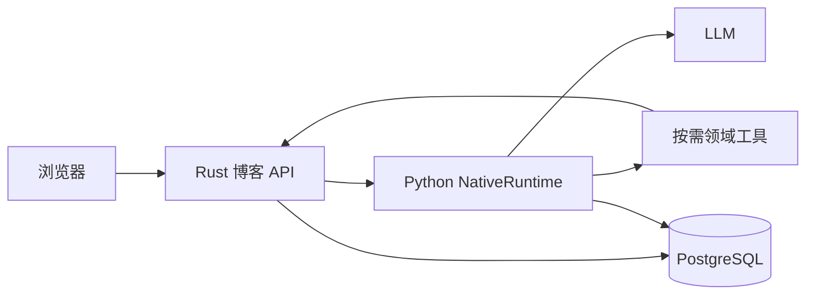

# Saudade Blog AI Agent 架构

本文描述当前主线实现。服务入口使用 `NativeRuntime`，原生工具循环直接由模型选择工具；旧 graph、planner、workflow DSL 与 hybrid 适配层已从生产依赖中删除，历史实现只存在于 Git 历史。

## 1. 系统总览

- 浏览器负责对话界面、SSE 消费及页面命令执行。
- Rust 博客后端负责鉴权、业务 API、聊天记录和 SSE 转发。
- Python Agent 负责模型调用、按需领域工具、确认、取消、幂等和事实回执。
- PostgreSQL 保存博客业务记录、Agent checkpoint 与幂等账；没有持久化配置时不保存会话状态；离线测试可显式注入内存 saver。
- 业务写入由领域事务服务完成，确认准备只读，执行阶段重新校验身份、版本和幂等键。



## 2. 组件与目录

目录树由 `tests/test_module_index.py` 与磁盘双向校验；树中的路径是当前源码，不包含已退役实现。

```
├── agent/                  # 原生运行时、权限、会话与领域模块
│   ├── __init__.py                                      # 当前生产代码模块
│   ├── action_text.py                                   # 当前生产代码模块
│   ├── adminops_account.py                              # 当前生产代码模块
│   ├── adminops_board.py                                # 当前生产代码模块
│   ├── adminops_comment.py                              # 当前生产代码模块
│   ├── adminops_quota.py                                # 当前生产代码模块
│   ├── adminops_tags.py                                 # 当前生产代码模块
│   ├── adminops_target.py                               # 当前生产代码模块
│   ├── adminops_todo.py                                 # 当前生产代码模块
│   ├── api/__init__.py                                  # HTTP 适配包，不执行应用初始化
│   ├── api/authentication.py                            # 宿主身份断言与端点权限
│   ├── api/routes/__init__.py                           # HTTP 路由包
│   ├── api/routes/moderation.py                         # 独立审核准入与接口
│   ├── api/routes/knowledge_graph.py                    # 图谱查询及后台建图接口
│   ├── main.py                                         # ASGI 应用工厂与路由装配
│   ├── api/dependencies.py                             # 应用资源解析及请求准入
│   ├── api/lifecycle.py                                # 启动与退出资源管理
│   ├── api/middleware.py                               # 请求体积与追踪上下文
│   ├── api/turns.py                                    # 显式运行时的调用和队列适配
│   ├── api/routes/chat.py                              # 聊天与 SSE 路由
│   ├── api/routes/conversations.py                     # 会话维护及确认取消
│   ├── api/routes/operations.py                        # 健康、就绪与版本
│   ├── api/context.py                                   # 请求到标准消息的适配与历史回放
│   ├── api/host_context.py                              # 有界宿主事实与历史任务投影
│   ├── api/events.py                                    # 具名 SSE 编码和响应头
│   ├── api/schemas.py                                   # 聊天 HTTP 契约及字段限额
│   ├── arg_refs.py                                      # 当前生产代码模块
│   ├── article_evidence.py                              # 当前生产代码模块
│   ├── authz.py                                         # 当前生产代码模块
│   ├── block_reasons.py                                 # 当前生产代码模块
│   ├── checkpoint.py                                    # 当前生产代码模块
│   ├── confirm.py                                       # 当前生产代码模块
│   ├── domains/__init__.py                              # 当前生产代码模块
│   ├── domains/account_actions/__init__.py              # 当前生产代码模块
│   ├── domains/account_actions/preparation.py           # 当前生产代码模块
│   ├── domains/account_actions/targets.py               # 当前生产代码模块
│   ├── domains/account_actions/transactions.py          # 当前生产代码模块
│   ├── domains/admin_pages.py                           # 当前生产代码模块
│   ├── domains/admin_writes.py                          # 当前生产代码模块
│   ├── domains/announcements/__init__.py                # 当前生产代码模块
│   ├── domains/announcements/preparation.py             # 当前生产代码模块
│   ├── domains/announcements/targets.py                 # 当前生产代码模块
│   ├── domains/announcements/transactions.py            # 当前生产代码模块
│   ├── domains/article_actions/__init__.py              # 当前生产代码模块
│   ├── domains/article_actions/preparation.py           # 当前生产代码模块
│   ├── domains/article_actions/targets.py               # 当前生产代码模块
│   ├── domains/article_actions/transactions.py          # 当前生产代码模块
│   ├── domains/article_metadata.py                      # 当前生产代码模块
│   ├── domains/article_tags/__init__.py                 # 当前生产代码模块
│   ├── domains/article_tags/preparation.py              # 当前生产代码模块
│   ├── domains/article_tags/targets.py                  # 当前生产代码模块
│   ├── domains/article_tags/transactions.py             # 当前生产代码模块
│   ├── domains/browser.py                               # 当前生产代码模块
│   ├── domains/catalog.py                               # 当前生产代码模块
│   ├── domains/categories/__init__.py                   # 当前生产代码模块
│   ├── domains/categories/preparation.py                # 当前生产代码模块
│   ├── domains/categories/targets.py                    # 当前生产代码模块
│   ├── domains/categories/transactions.py               # 当前生产代码模块
│   ├── domains/device_actions.py                        # 当前生产代码模块
│   ├── domains/device_reads.py                          # 当前生产代码模块
│   ├── domains/favorites/__init__.py                    # 当前生产代码模块
│   ├── domains/favorites/preparation.py                 # 当前生产代码模块
│   ├── domains/favorites/transactions.py                # 当前生产代码模块
│   ├── domains/messages/__init__.py                     # 当前生产代码模块
│   ├── domains/messages/preparation.py                  # 当前生产代码模块
│   ├── domains/messages/transactions.py                 # 当前生产代码模块
│   ├── domains/moderation.py                            # 当前生产代码模块
│   ├── domains/moderation_actions/__init__.py           # 当前生产代码模块
│   ├── domains/moderation_actions/preparation.py        # 当前生产代码模块
│   ├── domains/moderation_actions/targets.py            # 当前生产代码模块
│   ├── domains/moderation_actions/transactions.py       # 当前生产代码模块
│   ├── domains/notices/__init__.py                      # 当前生产代码模块
│   ├── domains/notices/preparation.py                   # 当前生产代码模块
│   ├── domains/notices/targets.py                       # 当前生产代码模块
│   ├── domains/notices/transactions.py                  # 当前生产代码模块
│   ├── domains/notifications/__init__.py                # 当前生产代码模块
│   ├── domains/notifications/preparation.py             # 当前生产代码模块
│   ├── domains/notifications/transactions.py            # 当前生产代码模块
│   ├── domains/own_activity.py                          # 当前生产代码模块
│   ├── domains/own_reads.py                             # 当前生产代码模块
│   ├── domains/public_activity.py                       # 当前生产代码模块
│   ├── domains/public_catalog.py                        # 当前生产代码模块
│   ├── domains/public_pages.py                          # 当前生产代码模块
│   ├── domains/quota_actions/__init__.py                # 当前生产代码模块
│   ├── domains/quota_actions/preparation.py             # 当前生产代码模块
│   ├── domains/quota_actions/targets.py                 # 当前生产代码模块
│   ├── domains/quota_actions/transactions.py            # 当前生产代码模块
│   ├── domains/read_state.py                            # 当前生产代码模块
│   ├── domains/registry.py                              # 当前生产代码模块
│   ├── domains/tags/__init__.py                         # 当前生产代码模块
│   ├── domains/tags/preparation.py                      # 当前生产代码模块
│   ├── domains/tags/targets.py                          # 当前生产代码模块
│   ├── domains/tags/transactions.py                     # 当前生产代码模块
│   ├── domains/todos/__init__.py                        # 当前生产代码模块
│   ├── domains/todos/preparation.py                     # 当前生产代码模块
│   ├── domains/todos/targets.py                         # 当前生产代码模块
│   ├── domains/todos/transactions.py                    # 当前生产代码模块
│   ├── domains/utilities.py                             # 当前生产代码模块
│   ├── domains/work_queue.py                            # 当前生产代码模块
│   ├── factblock.py                                     # 当前生产代码模块
│   ├── hostinfo.py                                      # 当前生产代码模块
│   ├── idem.py                                          # 当前生产代码模块
│   ├── idem_pg.py                                       # 当前生产代码模块
│   ├── llm_usage.py                                     # 当前生产代码模块
│   ├── moderator.py                                     # 当前生产代码模块
│   ├── principal.py                                     # 当前生产代码模块
│   ├── receipt_digest.py                                # 当前生产代码模块
│   ├── reports.py                                       # 当前生产代码模块
│   ├── runtime/__init__.py                              # 当前生产代码模块
│   ├── runtime/admin_domains.py                         # 当前生产代码模块
│   ├── runtime/budget.py                                # 当前生产代码模块
│   ├── runtime/capabilities.py                          # 当前生产代码模块
│   ├── runtime/catalog.py                               # 当前生产代码模块
│   ├── runtime/checkpoint_store.py                      # 当前生产代码模块
│   ├── runtime/confirmation.py                          # 当前生产代码模块
│   ├── runtime/context.py                               # 当前生产代码模块
│   ├── runtime/control.py                               # 当前生产代码模块
│   ├── runtime/conversation_store.py                    # 当前生产代码模块
│   ├── runtime/workers.py                              # 请求线程与启动预热的服务生命周期
│   ├── runtime/jobs.py                                  # 当前生产代码模块
│   ├── runtime/memory.py                                # 当前生产代码模块
│   ├── runtime/model_budget.py                          # 当前生产代码模块
│   ├── runtime/narration.py                              # 已确认执行后的有界只读叙述
│   ├── runtime/native.py                                # 当前生产代码模块
│   ├── runtime/native_store.py                          # 当前生产代码模块
│   ├── runtime/pending.py                               # 当前生产代码模块
│   ├── runtime/persona.py                               # 当前生产代码模块
│   ├── runtime/progress.py                              # 当前生产代码模块
│   ├── runtime/prompt.py                                # 当前生产代码模块
│   ├── runtime/read_tools.py                            # 当前生产代码模块
│   ├── runtime/results.py                               # 当前生产代码模块
│   ├── runtime/session.py                               # 当前生产代码模块
│   ├── runtime/turns.py                                 # 当前生产代码模块
│   ├── runtime/writes.py                                # 当前生产代码模块
│   ├── runtime_probe.py                                 # 当前生产代码模块
│   ├── stickers.py                                      # 当前生产代码模块
│   ├── summarizer.py                                    # 当前生产代码模块
│   └── transport.py                                     # 当前生产代码模块
├── tools/                  # 业务工具与共享结果协议
│   ├── __init__.py                                      # 当前生产代码模块
│   ├── account_admin.py                                 # 当前生产代码模块
│   ├── admin_read.py                                    # 当前生产代码模块
│   ├── announcements.py                                 # 当前生产代码模块
│   ├── base.py                                          # 当前生产代码模块
│   ├── board_moderation.py                              # 当前生产代码模块
│   ├── category_admin.py                                # 当前生产代码模块
│   ├── comment_moderation.py                            # 当前生产代码模块
│   ├── dashboard_todos.py                               # 当前生产代码模块
│   ├── device.py                                        # 当前生产代码模块
│   ├── note_admin.py                                    # 当前生产代码模块
│   ├── notes.py                                         # 当前生产代码模块
│   ├── own_data.py                                      # 当前生产代码模块
│   ├── notifications.py                                 # 有界通知读取、详情和原始定位链接
│   ├── quota_admin.py                                   # 当前生产代码模块
│   ├── result.py                                        # 当前生产代码模块
│   ├── site.py                                          # 当前生产代码模块
│   └── tag_admin.py                                     # 当前生产代码模块
```

历史路径对照：`agent/graph.py` → `agent/runtime/native.py`（已改名，历史记录）。

## 3. 一次对话的完整链路

1. `agent/main.py` 装配应用；聊天路由从请求所属应用获取运行时和资源，
   `agent/api/turns.py` 将已验证的 principal、会话坐标和预算绑定到原生调用。
2. `NativeRuntime.stream_events` 从 `ConversationStore` 恢复消息与待确认状态，并交给 `ToolSession`。
3. 会话先发送按需领域目录；模型直接返回标准 LangChain tool call，代码检查权限、参数、确认和业务版本。
4. 只读工具直接产生受边界约束的结果；写工具先返回确认卡，确认后的下一轮由签名执行入口调用领域事务。
5. 传输层把正文增量、进度、命令、确认卡、receipt 和结束帧编码为现有 HTTP/SSE 协议。最终正文只在 `TurnResult` 保存一次。
6. 轮次完成后由会话存储提交历史和执行事实；取消、断连、截止时间和预算超限在循环边界与工具边界生效。

## 4. 运行时边界

- 过程事件展示实际加载的工具领域、工具调用名和已启动的会话摘要任务；不展示参数、凭据或模型内部推理。工具返回仅代表调用结束，业务成功仍以结构化回执为准。
- 已确认写入先完成确定性执行和幂等账，再进行一次无工具的自然语言叙述（关闭思考、最多 192 输出 token、10 秒传输超时、无自动重试，受整轮剩余预算约束）。失败、预算不足或输出截断时使用事实文本；独立保存真实工具回执，模型措辞不构成执行或授权依据。自由文本的事实一致性仍需真实请求评测。
- 文章发现依据真实候选提供标题与链接；正文总结与比较需读取正文。候选来源校验不强制所有检索都追加全文读取，也不替代回答语义评测。

- `NativeConversationStore` 只使用 LangGraph saver 的公开 `get_state`/`update_state` 接口保存会话历史、待确认状态和完成轮次；它不是业务图，也不提供每一步崩溃恢复。
- 普通读取中断后可以重新读取；未知写入结果必须先查询已有回执，不能盲目重试。
- 会话使用稳定 `thread_id`、串行锁和删除屏障；不同用户与会话的历史相互隔离。
- 生产不识别 `AGENT_ARM=hybrid/graph`，未知执行器直接拒绝；旧模块不在新进程的导入闭包中。

## 5. 验证与评测

```bash
uv sync --locked
uv run ruff check --select F821 .
uv run pytest -q
npm --prefix frontend test
```

行为测试优先验证用户可见结果与实际副作用：原生工具往返、确认/取消/幂等、存储删除屏障、预算和 SSE 传输。跨仓契约测试使用固定的 Saudade-Blog 提交；没有父仓 checkout 时，相关测试必须明确标为未执行。

## 6. 兼容边界

当前服务只支持原生运行时。`thread_id`、确认签名、receipt、SSE 帧和宿主请求字段保持兼容；暂时接收但不再使用的旧 planner 字段在入口处忽略并记录迁移说明。旧 graph/hybrid 不再作为回退路径，也没有隐藏兼容开关。

### checkpoint 资源归属

应用 lifespan 用标准库 `ExitStack` 管理本次创建的连接池，运行时工厂显式接收该资源作用域。
任务与追踪收尾后才关闭所属连接池；启动失败只清理本次资源。没有按 DSN 缓存的进程级池，
多个应用或评测作用域可以独立创建与关闭。会话锁、删除屏障和执行账仍使用对应 saver 的池。
