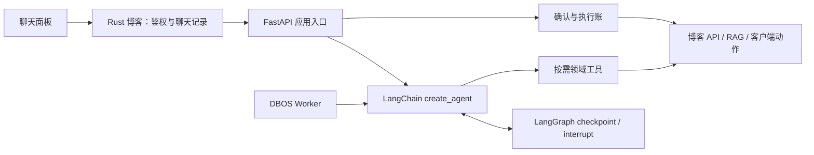

# 架构

本项目是博客业务应用，使用现有框架承担模型循环、持久执行与调度。自定义代码负责应用身份、业务确认、预算、事实回执和产品交互。

框架选型、权限与事务、恢复和资源边界的理由及取代关系见[架构决策记录](adr/README.md)。

## 组件与数据流

1. 宿主验证登录状态，签发短期身份断言，传递会话坐标和经过边界校验的页面观察。
2. 应用入口显式装配产品提示、领域目录、权限与基础设施，取得会话运行许可。
3. LangChain 执行模型与工具循环。工具返回标准消息及结构化 artifact；错误、空结果和成功有不同状态。
4. 需要人工确认或浏览器回报时，LangGraph interrupt 持久暂停；接续使用同一任务坐标及剩余预算。
5. 用户批准后，确定性代码重新校验目标并通过执行账防重复调用。模型可以叙述真实结果，不能自行宣布写入成功。
6. 完整轮次提交至会话状态；SSE 交付进度、正文和结构化卡片。HTTP 断开不等于远端模型或业务请求已经停止。

## 代码导航

| 目录 | 职责 |
| --- | --- |
| `agent/` | 应用、运行时、领域、后台计划和服务接口 |
| `agent/runtime/` | 框架接线、执行、会话、预算和上下文 middleware |
| `agent/domains/` | 领域能力登记、读工具和操作准备 |
| `agent/products/` | 博客人设及产品适配 |
| `tools/` | 博客 API、设备与业务接口适配 |
| `config/` | 配置、日志及能力描述 |
| `models/` | 模型提供商适配和调用边界 |
| `rag/` | 语料、分块、BM25、向量和证据读取 |
| `utils/` | 共享协议、追踪和基础设施辅助 |
| `frontend/` | 看板娘与聊天组件，博客通过固定提交及子树哈希引入 |
| `eval/`、`tests/` | 真实模型评测、质量工具和确定性回归 |

## 状态与职责边界

- **Conversation** 保存来源匹配的记忆；**Task** 保存执行坐标及累计预算；HTTP 请求只管理当前连接、截止时间和取消信号。
- checkpoint 保存可恢复执行，执行账保存业务效果；聊天正文、摘要和页面数据均不是授权凭据。
- 框架 state 是任务状态真源，Session 是节点工作视图，不能维护另一个脱离框架的执行状态机。
- 后端负责业务事务、版本条件、相对时间和分页；Agent 负责理解目标、选择能力、补充查询和解释结果。
- 公开原文按类型、ID 和 Unicode 范围读取，续读携带内容版本与章节解析签名；统计信息按需独立查询。RAG 导出按完整文档的 JSON 字节分页，不切断正文或把短页当作结束。
- 调度使用 DBOS 的公开 API，不以模型循环轮询等待，不在聊天连接中挂定时器。
- 图库、后台文章与账号查询的领域只加载读取工具；变更准备使用独立领域，已知 ID 可直接准备，由后端复核目标。加载后的工具沿用热工作集预算与权限复核，不另建菜单缓存。
- 私有执行清单沿用 LangChain 的 checkpointed todo middleware，通过 `task_planning` 按需加载工具与说明；闲聊、简单查询及记忆请求不承担其完整 schema 开销。清单不构成业务授权，用户待办与提醒仍由对应业务工具处理。
- 领域不能反向依赖博客人设；应用入口负责装配。通用能力优先使用成熟库，不新增规划 DSL 或自研调度框架。

## 交互并发与后台执行

当前聊天支持流式执行和在途补充要求；后台定时任务由独立 DBOS Worker 执行。
这些能力不代表普通聊天请求已经成为脱离连接的后台任务。

- 不同会话可在服务并发许可内同时执行；同一会话的模型轮次由会话锁串行化。
- 在途补充要求经独立输入接口入库，不等待模型轮锁；在模型调用边界消费。
  接收成功不等于模型已经采用，客户端根据 `task_input` 状态区分两者；
  无法即时抢占正在执行的模型或工具，也不能撤销已发生的业务效果。
- 当前网页在流式执行期间禁止切换或新建会话，发送框用于补充当前任务。
  接续已持久暂停的任务是显式操作；不会并行启动同一会话的第二条模型执行链。
- 普通聊天断连会发出取消信号；checkpoint 保留恢复所需状态，不保证断连后继续完成。
  已提交的短写入可能继续收尾，不能把断连当作业务回滚。
- 定时任务拥有独立执行身份、队列、预算及通知交付，不依赖聊天连接，见[调度](scheduling.md)。

跨会话后台聊天和根据新消息协调多个任务暂不实施；近期保留上述交互边界，聚焦性能、
成本与正式版验收。长期目标是可迁移的通用 Agent，任务隔离、语义调整、挂起恢复与
受控并行的设计及重新启动条件见 [ADR-0038](adr/adr-0038-general-agent-and-release-priorities.md)。

## 运行与故障

运行任务数与打开网页数无关。闲置网页不会占用模型执行许可；活动请求、审查和后台 Worker 各有限流。许可只在生产者实际退出时释放。模型调用、关闭等待与线程退出都有边界；无法确定停止时记录未知状态，而非声称远端已停止计费。

PostgreSQL 会话锁串行化同一会话，删除屏障阻止迟到执行恢复已删除数据。数据库连接预算须包含 checkpoint、会话锁及后台任务。跨模型等待不持有业务数据库长事务。

详细契约见[记忆](conversation-memory.md)、[授权](identity-and-permissions.md)、[协议](chat-stream-protocol.md)和[调度](scheduling.md)。
