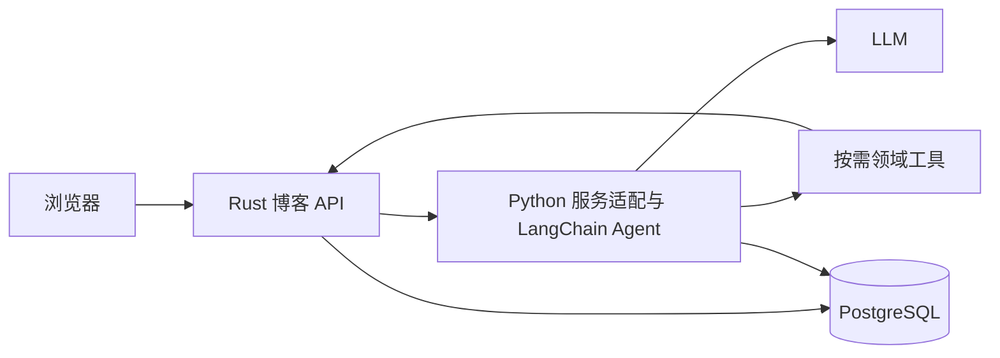

# Saudade Blog AI Agent 架构

本文描述当前主线实现。`NativeRuntime` 适配服务与会话协议，`ToolSession` 调用 LangChain
`create_agent` 执行模型—工具循环；业务工具由模型选择。旧 planner、workflow DSL 与 hybrid
适配层已从生产依赖中删除，历史实现保留在 Git 历史。

长期执行内核与领域扩展方向见 [ADR-0024](adr/adr-0024-framework-kernel-and-domain-extensions.md)。
当前模型调用、标准消息聚合和轮次调度由框架负责，公开 middleware 接入预算、取消、
工具授权与业务结果规则。LangGraph 的持久 Agent 子图及 interrupt/Command 接续签名确认，
自建工具游标已删除。博客工具、人设、文章证据和确认协议由 `products/blog` 显式装配，
通过标准 middleware 接入；非博客库存示例复用同一运行时，见 [产品扩展](product-extensions.md)。

## 1. 系统总览

- 浏览器负责对话界面、SSE 消费及页面命令执行。
- Rust 博客后端负责鉴权、业务 API、聊天记录和 SSE 转发。
- Python Agent 负责模型调用、按需领域工具、确认、取消、幂等和事实回执。
- PostgreSQL 保存博客业务记录、Agent checkpoint 与幂等账；没有持久化配置时不保存会话状态；离线测试可显式注入内存 saver。
- 业务写入由领域事务服务完成，确认准备只读，执行阶段重新校验身份、版本和幂等键。



## 2. 组件与目录

目录树由 `tests/test_module_index.py` 与磁盘双向校验；树中的路径是当前源码，不包含已退役实现。

```
├── agent/                  # 原生运行时、权限、会话与领域模块
│   ├── __init__.py                                      # 当前生产代码模块
│   ├── action_text.py                                   # 当前生产代码模块
│   ├── adminops_account.py                              # 当前生产代码模块
│   ├── adminops_board.py                                # 当前生产代码模块
│   ├── adminops_comment.py                              # 当前生产代码模块
│   ├── adminops_quota.py                                # 当前生产代码模块
│   ├── adminops_tags.py                                 # 当前生产代码模块
│   ├── adminops_target.py                               # 当前生产代码模块
│   ├── adminops_todo.py                                 # 当前生产代码模块
│   ├── api/__init__.py                                  # HTTP 适配包，不执行应用初始化
│   ├── api/authentication.py                            # 宿主身份断言与端点权限
│   ├── api/routes/__init__.py                           # HTTP 路由包
│   ├── api/routes/moderation.py                         # 独立审核准入与接口
│   ├── api/routes/knowledge_graph.py                    # 图谱查询及后台建图接口
│   ├── main.py                                         # ASGI 应用工厂与路由装配
│   ├── api/dependencies.py                             # 应用资源解析及请求准入
│   ├── api/lifecycle.py                                # 启动与退出资源管理
│   ├── api/middleware.py                               # 请求体积与追踪上下文
│   ├── api/turns.py                                    # 显式运行时的调用和队列适配
│   ├── api/routes/chat.py                              # 聊天与 SSE 路由
│   ├── api/routes/conversations.py                     # 会话维护及确认取消
│   ├── api/routes/task_inputs.py                       # 运行中补充消息的认证入口与状态查询
│   ├── api/routes/operations.py                        # 健康、就绪与版本
│   ├── api/context.py                                   # 请求到标准消息的适配与历史回放
│   ├── api/host_context.py                              # 有界宿主事实与历史任务投影
│   ├── api/events.py                                    # 具名 SSE 编码和响应头
│   ├── api/schemas.py                                   # 聊天 HTTP 契约及字段限额
│   ├── confirmation_args.py                             # 确认参数的未解析占位符检查
│   ├── domains/articles/__init__.py                    # 文章领域包
│   ├── domains/articles/evidence.py                    # 候选、已读正文与文章来源证据
│   ├── authz.py                                         # 当前生产代码模块
│   ├── checkpoint.py                                    # 当前生产代码模块
│   ├── confirm.py                                       # 当前生产代码模块
│   ├── domains/__init__.py                              # 当前生产代码模块
│   ├── domains/account_actions/__init__.py              # 当前生产代码模块
│   ├── domains/account_actions/preparation.py           # 当前生产代码模块
│   ├── domains/account_actions/targets.py               # 当前生产代码模块
│   ├── domains/account_actions/transactions.py          # 当前生产代码模块
│   ├── domains/admin_pages.py                           # 当前生产代码模块
│   ├── domains/admin_writes.py                          # 当前生产代码模块
│   ├── domains/announcements/__init__.py                # 当前生产代码模块
│   ├── domains/announcements/preparation.py             # 当前生产代码模块
│   ├── domains/announcements/targets.py                 # 当前生产代码模块
│   ├── domains/announcements/transactions.py            # 当前生产代码模块
│   ├── domains/article_actions/__init__.py              # 当前生产代码模块
│   ├── domains/article_actions/preparation.py           # 当前生产代码模块
│   ├── domains/article_actions/batch.py                 # 一次确认的有界文章批量事务
│   ├── domains/article_actions/targets.py               # 当前生产代码模块
│   ├── domains/article_actions/transactions.py          # 当前生产代码模块
│   ├── domains/article_metadata.py                      # 当前生产代码模块
│   ├── domains/article_tags/__init__.py                 # 当前生产代码模块
│   ├── domains/article_tags/preparation.py              # 当前生产代码模块
│   ├── domains/article_tags/targets.py                  # 当前生产代码模块
│   ├── domains/article_tags/transactions.py             # 当前生产代码模块
│   ├── domains/browser.py                               # 当前生产代码模块
│   ├── domains/conversation_images.py                   # 当前会话历史原图的鉴权回看
│   ├── domains/catalog.py                               # 当前生产代码模块
│   ├── domains/categories/__init__.py                   # 当前生产代码模块
│   ├── domains/categories/preparation.py                # 当前生产代码模块
│   ├── domains/categories/targets.py                    # 当前生产代码模块
│   ├── domains/categories/transactions.py               # 当前生产代码模块
│   ├── domains/device_actions.py                        # 当前生产代码模块
│   ├── domains/device_reads.py                          # 当前生产代码模块
│   ├── domains/favorites/__init__.py                    # 当前生产代码模块
│   ├── domains/favorites/preparation.py                 # 当前生产代码模块
│   ├── domains/favorites/transactions.py                # 当前生产代码模块
│   ├── domains/messages/__init__.py                     # 当前生产代码模块
│   ├── domains/messages/preparation.py                  # 当前生产代码模块
│   ├── domains/messages/transactions.py                 # 当前生产代码模块
│   ├── domains/moderation.py                            # 当前生产代码模块
│   ├── domains/moderation_actions/__init__.py           # 当前生产代码模块
│   ├── domains/moderation_actions/preparation.py        # 当前生产代码模块
│   ├── domains/moderation_actions/targets.py            # 当前生产代码模块
│   ├── domains/moderation_actions/transactions.py       # 当前生产代码模块
│   ├── domains/notices/__init__.py                      # 当前生产代码模块
│   ├── domains/notices/preparation.py                   # 当前生产代码模块
│   ├── domains/notices/targets.py                       # 当前生产代码模块
│   ├── domains/notices/transactions.py                  # 当前生产代码模块
│   ├── domains/notifications/__init__.py                # 当前生产代码模块
│   ├── domains/notifications/preparation.py             # 当前生产代码模块
│   ├── domains/notifications/transactions.py            # 当前生产代码模块
│   ├── domains/own_activity.py                          # 当前生产代码模块
│   ├── domains/own_reads.py                             # 当前生产代码模块
│   ├── domains/public_activity.py                       # 当前生产代码模块
│   ├── domains/pagination.py                            # 紧凑目录元数据的分页参数上限
│   ├── domains/public_catalog.py                        # 当前生产代码模块
│   ├── domains/public_pages.py                          # 当前生产代码模块
│   ├── domains/quota_actions/__init__.py                # 当前生产代码模块
│   ├── domains/quota_actions/preparation.py             # 当前生产代码模块
│   ├── domains/quota_actions/targets.py                 # 当前生产代码模块
│   ├── domains/quota_actions/transactions.py            # 当前生产代码模块
│   ├── domains/read_state.py                            # 当前生产代码模块
│   ├── domains/registry.py                              # 当前生产代码模块
│   ├── domains/tags/__init__.py                         # 当前生产代码模块
│   ├── domains/tags/preparation.py                      # 当前生产代码模块
│   ├── domains/tags/targets.py                          # 当前生产代码模块
│   ├── domains/tags/transactions.py                     # 当前生产代码模块
│   ├── domains/todos/__init__.py                        # 当前生产代码模块
│   ├── domains/todos/preparation.py                     # 当前生产代码模块
│   ├── domains/todos/targets.py                         # 当前生产代码模块
│   ├── domains/todos/transactions.py                    # 当前生产代码模块
│   ├── domains/utilities.py                             # 当前生产代码模块
│   ├── domains/work_queue.py                            # 当前生产代码模块
│   ├── factblock.py                                     # 当前生产代码模块
│   ├── hostinfo.py                                      # 当前生产代码模块
│   ├── idem.py                                          # 当前生产代码模块
│   ├── idem_pg.py                                       # 当前生产代码模块
│   ├── llm_usage.py                                     # 当前生产代码模块
│   ├── moderator.py                                     # 当前生产代码模块
│   ├── principal.py                                     # 当前生产代码模块
│   ├── reports.py                                       # 当前生产代码模块
│   ├── products/__init__.py                            # 产品装配包
│   ├── products/blog/__init__.py                        # 博客产品包
│   ├── products/blog/application.py                     # 博客工具、身份上下文与标准 middleware 装配
│   ├── products/blog/articles.py                        # 文章结果渲染、来源校验与框架状态扩展
│   ├── products/blog/admin_domains.py                   # 管理员读取与确认准备工具装配
│   ├── products/blog/capabilities.py                    # 博客领域能力目录及按身份装配
│   ├── products/blog/catalog.py                         # 博客领域说明与高频页面设备工具晋升
│   ├── products/blog/confirmation.py                    # 博客签名卡执行路由、取消与传输适配
│   ├── products/blog/context.py                         # 博客称呼、渲染能力与会话路由坐标
│   ├── products/blog/history.py                         # 博客页面及图片观察的历史访问规则
│   ├── products/blog/narration.py                       # 既有确认卡的有界事实叙述
│   ├── products/blog/pending.py                         # 博客签名卡撤销、替换与恢复校验
│   ├── products/blog/persona.py                         # 博客角色与表达风格
│   ├── products/blog/prompt.py                          # 博客指令、可信身份与页面上下文装配
│   ├── products/blog/read_tools.py                      # 博客读取工具集合与领域配置
│   ├── products/blog/tool_policy.py                     # 调用前授权与浏览器、设备回执校验
│   ├── runtime/access.py                              # 验签身份及 scope 守卫
│   ├── runtime/__init__.py                              # 当前生产代码模块
│   ├── runtime/approval.py                              # 框架持久审批中断与执行回执提交
│   ├── runtime/execution.py                             # 标准 Agent 子图与会话审批图组合
│   ├── runtime/client_actions.py     # 浏览器回报的框架中断与绑定校验
│   ├── runtime/execution_state.py                       # 工具领域、来源证据与待审批状态
│   ├── runtime/task_input_store.py                      # 跨进程任务输入的短事务存储
│   ├── runtime/task_budget.py                           # 跨请求任务用量预留、结算与会话级清理
│   ├── runtime/tool_execution.py                        # 框架工具执行前后的预算、发现与结果投影
│   ├── runtime/tool_outputs.py                          # 业务结果适配标准工具内容与 artifact
│   ├── runtime/retention.py                             # 独立于模型窗口的工作记忆保留上限
│   ├── runtime/task_input_policy.py                     # 标准模型边界消费补充消息及应用事件
│   ├── runtime/task_inputs.py                           # 幂等输入、接收状态与任务封口
│   ├── runtime/task_scope.py                            # 与工具权限独立的任务身份绑定
│   ├── runtime/recovery.py                              # 普通任务绑定与标准 checkpoint 续跑适配
│   ├── runtime/budget.py                                # 当前生产代码模块
│   ├── runtime/input_usage.py                           # 相同模型及请求前缀复用服务商输入用量
│   ├── runtime/tool_errors.py                           # 参数字段错误反馈，不回显原始输入
│   ├── runtime/tool_state.py                            # 与历史窗口独立的授权工具激活状态
│   ├── runtime/catalog.py                               # 当前生产代码模块
│   ├── runtime/checkpoint_store.py                      # 当前生产代码模块
│   ├── runtime/control.py                               # 当前生产代码模块
│   ├── runtime/conversation_store.py                    # 当前生产代码模块
│   ├── runtime/response_validation.py                   # 校验提供商停止原因与正文控制标记
│   ├── runtime/workers.py                              # 请求线程与启动预热的服务生命周期
│   ├── runtime/jobs.py                                  # 当前生产代码模块
│   ├── runtime/memory_media.py                          # 多模态消息的历史引用与临时图片适配
│   ├── runtime/compaction.py                            # 标准摘要中间件与持久提交适配
│   ├── runtime/summarization.py                         # 完整来源摘要与共享请求预算
│   ├── runtime/memory_scope.py                          # 宿主历史与摘要的来源边界
│   ├── runtime/message_content.py                       # 共用文本提取与框架 token 估算
│   ├── runtime/visible_text.py                          # 流式正文控制包隔离，不将文本解析为动作
│   ├── runtime/prompt_budget.py                         # 当前请求与工具 schema 预留后的历史预算
│   ├── runtime/memory.py                                # 当前生产代码模块
│   ├── runtime/model_budget.py                          # 当前生产代码模块
│   ├── runtime/middleware.py                            # 标准 Agent 的预算、权限与业务结果适配
│   ├── runtime/native.py                                # 当前生产代码模块
│   ├── runtime/native_store.py                          # 当前生产代码模块
│   ├── runtime/progress.py                              # 当前生产代码模块
│   ├── runtime/results.py                               # 当前生产代码模块
│   ├── runtime/session.py                               # 当前生产代码模块
│   ├── runtime/tool_evidence.py                         # 关联工具调用与已验证的准备事实
│   ├── runtime/trace_context.py                         # 记录实际工具契约、调用者与轮次状态
│   ├── runtime/turns.py                                 # 当前生产代码模块
│   ├── runtime/writes.py                                # 当前生产代码模块
│   ├── runtime_probe.py                                 # 当前生产代码模块
│   ├── stickers.py                                      # 当前生产代码模块
│   └── transport.py                                     # 当前生产代码模块
├── tools/                  # 业务工具与共享结果协议
│   ├── __init__.py                                      # 当前生产代码模块
│   ├── account_admin.py                                 # 当前生产代码模块
│   ├── admin_read.py                                    # 当前生产代码模块
│   ├── base.py                                          # 当前生产代码模块
│   ├── board_moderation.py                              # 当前生产代码模块
│   ├── category_admin.py                                # 当前生产代码模块
│   ├── dashboard_todos.py                               # 当前生产代码模块
│   ├── device.py                                        # 当前生产代码模块
│   ├── note_admin.py                                    # 当前生产代码模块
│   ├── notes.py                                         # 当前生产代码模块
│   ├── own_data.py                                      # 当前生产代码模块
│   ├── notifications.py                                 # 有界通知读取、详情和原始定位链接
│   ├── quota_admin.py                                   # 当前生产代码模块
│   ├── result.py                                        # 当前生产代码模块
│   ├── site.py                                          # 当前生产代码模块
│   └── tag_admin.py                                     # 当前生产代码模块
```

历史路径对照：`agent/graph.py` → `agent/runtime/native.py`（已改名，历史记录）。

## 3. 一次对话的完整链路

1. `agent/main.py` 装配应用；聊天路由从请求所属应用获取运行时和资源，
   `agent/api/turns.py` 将已验证的 principal、会话坐标和预算绑定到原生调用。
2. `NativeRuntime.stream_events` 从 `ConversationStore` 恢复消息与待确认状态，并交给 `ToolSession`。
3. 会话先发送按需领域目录；模型直接返回标准 LangChain tool call，代码检查权限、参数、确认和业务版本。账号名录与账号操作在同一领域，不必加载文章管理工具来核实账号。
4. 只读工具直接产生受边界约束的结果；写工具先返回确认卡，确认后的下一轮由签名执行入口调用领域事务。
5. 传输层把正文增量、进度、命令、确认卡、receipt 和结束帧编码为现有 HTTP/SSE 协议。最终正文只在 `TurnResult` 保存一次。
6. 轮次完成后由会话存储提交历史和执行事实。模型 I/O 通过标准异步接口响应停止与截止时间，
   关闭本次响应后再结束生产者；工具与业务事务继续在既有操作边界检查。
   跨线程入口和连接池由应用资源生命周期管理，见 [ADR-0027](adr/adr-0027-cancellable-model-io.md)。

## 4. 运行时边界

- 过程事件展示实际加载的工具领域、工具调用名和已启动的会话摘要任务；不展示参数、凭据或模型内部推理。工具返回仅代表调用结束，业务成功仍以结构化回执为准。
- 已确认写入先完成确定性执行和幂等账，再由框架审批节点持久提交事实并恢复标准 Agent 子图；没有暂停位置的既有卡片使用有界、无工具的自然语言叙述。两条路径均受当前请求预算约束，独立保存真实工具回执；模型措辞不构成执行或授权依据。故障与重放边界见 [ADR-0023](adr/adr-0023-confirmation-continuation.md)。
- 目标已有定位线索时先用工具核实，真实歧义才请用户选择；操作政策由业务服务核验，不由模型编造。提示词和工具可达性的回归分别验证，离线脚本不能证明真实模型始终遵守这些原则。
- 文章发现依据真实候选提供标题与链接；正文总结与比较需读取正文。候选来源校验不强制所有检索都追加全文读取，也不替代回答语义评测。

- `NativeConversationStore` 只使用 LangGraph saver 的公开 `get_state`/`update_state` 接口保存会话历史、待确认状态和完成轮次；它不是业务图，也不提供每一步崩溃恢复。
- 普通读取中断后可以重新读取；未知写入结果必须先查询已有回执，不能盲目重试。
- 会话使用稳定 `thread_id`、串行锁和删除屏障；不同用户与会话的历史相互隔离。
- 服务只有原生运行时；旧 `AGENT_ARM` 仅接受迁移值 `native`，其他值拒绝。旧模块不在导入闭包中。

## 5. 验证与评测

```bash
uv sync --locked
uv run ruff check --select F821 .
uv run pytest -q
npm --prefix frontend test
```

行为测试优先验证用户可见结果与实际副作用：原生工具往返、确认/取消/幂等、存储删除屏障、预算和 SSE 传输。跨仓契约测试使用固定的 Saudade-Blog 提交；没有父仓 checkout 时，相关测试必须明确标为未执行。

## 6. 兼容边界

当前服务只支持原生运行时。`thread_id`、确认签名、receipt、SSE 帧和宿主请求字段保持兼容；暂时接收但不再使用的旧 planner 字段在入口处忽略并记录迁移说明。旧 graph/hybrid 不再作为回退路径，也没有隐藏兼容开关。

### checkpoint 资源归属

应用 lifespan 用标准库 `ExitStack` 管理本次创建的连接池，运行时工厂显式接收该资源作用域。
任务与追踪收尾后才关闭所属连接池；启动失败只清理本次资源。没有按 DSN 缓存的进程级池，
多个应用或评测作用域可以独立创建与关闭。会话锁、删除屏障和执行账仍使用对应 saver 的池。

会话记忆采用近期消息、来源受限的摘要及有界工具证据；图片历史仅保留引用与已有分析，
按需通过宿主鉴权接口回看。宿主冷启动历史接纳、权限来源和兼容影响见
[会话记忆契约](conversation-memory.md)。


### 天气读取

`get_weather` 使用单一 [Open-Meteo 接口](https://open-meteo.com/en/docs)，先以官方
[地理编码](https://open-meteo.com/en/docs/geocoding-api)核实地点，再读取当前天气模型数据。
城市必填，没有默认城市。重名时返回最多五个带行政区、国家和编号的候选；依据已有语境
选定候选，仍有歧义才询问用户，不在代码里凭关键词或人口阈值猜测地点。

结果带来源、有效时刻、时区和模型估算标记，不能称为气象站实测。校验单位、数值和有效
时刻，拒绝超过一小时或未来超过五分钟的数据。两次读取均受当前请求截止时间、响应大小
和取消边界约束；故障返回 unavailable 并在 trace 区分地理编码、天气读取及错误类型，
不自动切换其他供应商。旧工具入口委托同一实现，不再保留独立 wttr 路径。

免费公开端点仅供非商业使用；数据与地点来源署名随结果返回。商业部署需要按
[服务条款](https://open-meteo.com/en/terms)评估付费服务或自托管，当前不提供商业 SLA。
`location_id` 是本次搜索结果的候选编号，不允许提供任意坐标或外部 URL 绕过地点核对。
