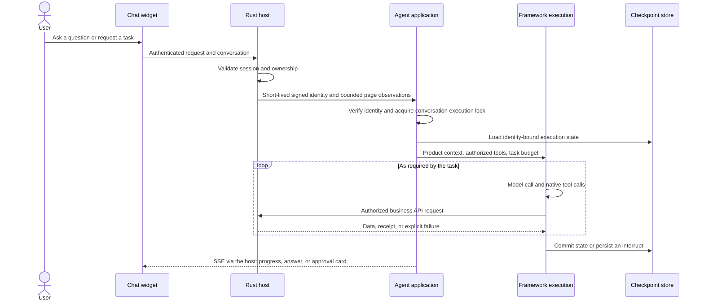

# Architecture and execution

[Guide](README.md) · [中文：架构](../agent-architecture.md)

## The system boundary

Saudade Blog Agent is a blog application built on existing agent frameworks. LangChain `create_agent` runs the model/tool loop; LangGraph supplies checkpointing and interrupt/resume. DBOS runs supported scheduled work. The project implements application wiring and policies around these components rather than a replacement graph engine or scheduler.

The Rust host owns accounts, business permissions, articles, drafts, and business transactions. The Python service owns model execution, runtime memory, task budgets, approval state, and its execution ledger. The browser owns the editor's working copy and reports the outcome of actual page actions. A browser acknowledgment is not a database commit receipt.

## One conversation turn

Streaming can happen throughout this sequence. Persistence, presentation, and business completion have different boundaries; a plausible final sentence cannot prove a write succeeded.

## State ownership

| Object | Responsibility |
| --- | --- |
| Conversation | Source-matched runtime memory, activated domains, and user ownership |
| Task | Execution coordinates, pending work, and cumulative model/tool/time budget |
| HTTP request | Current connection, deadline, cancellation, and incremental usage |
| Framework checkpoint | Resumable execution state; the session object is a working view |
| Execution ledger | Dispatch ownership and recorded tool outcomes |
| Host business transaction | Actual data changes, version checks, and supported idempotent receipts |

Conversation ownership comes from verified identity and checkpoint metadata. It is not inferred from a thread name, a request body's user ID, a message, or a summary. A role change does not change ownership; permissions and resumability must be checked against the current identity.

## Tools and dependency direction

The application composition root supplies the product, authorized domain catalog, model transport, state stores, and optional scheduling. The model can discover a permitted domain and load its tool schemas when needed. Loading is not a separate intent-classifier model and does not grant execution authority.

Shared runtime and domain packages do not import the blog persona/product package. Product code selects behavior; domain packages own preparation, target checks, and approved transaction adapters. This separation makes a permission or tool change reviewable without rewriting the model loop.

## Concurrency and cancellation

Different conversations can execute within service limits; one conversation's model turns are serialized. In-flight task input is accepted through a separate path and consumed at model-call boundaries. Acceptance does not mean the current model call has already used it.

A normal disconnected chat emits cancellation. Checkpoints preserve recovery state but do not guarantee the task continues without the connection. Remote model calls and already-started short writes may still finish. Scheduled tasks are separate durable DBOS work with their own authorization, queue, budget, and notification delivery.

Cross-conversation autonomous task coordination is not a current guarantee. The [future architecture decision](../adr/adr-0038-general-agent-and-release-priorities.md) is explicitly separate from current behavior.

## Follow the code

| Entry | What to inspect |
| --- | --- |
| [agent/main.py](../../agent/main.py), [composition.py](../../agent/composition.py) | HTTP creation and explicit resource composition |
| [Runtime service](../../agent/runtime/service.py) | Framework wiring, memory, budgets, tools, and recovery |
| [Blog application](../../agent/products/blog/application.py) | Blog product context and adapters |
| [Domain registry](../../agent/domains/registry.py) | Capability registration, reads, proposals, and controlled execution |
| [Application boundary tests](../../tests/runtime/test_application_boundaries.py) | Enforced dependency direction |

Continue with [context and retrieval](context-and-retrieval.md) and [safety and recovery](safety-and-recovery.md).
