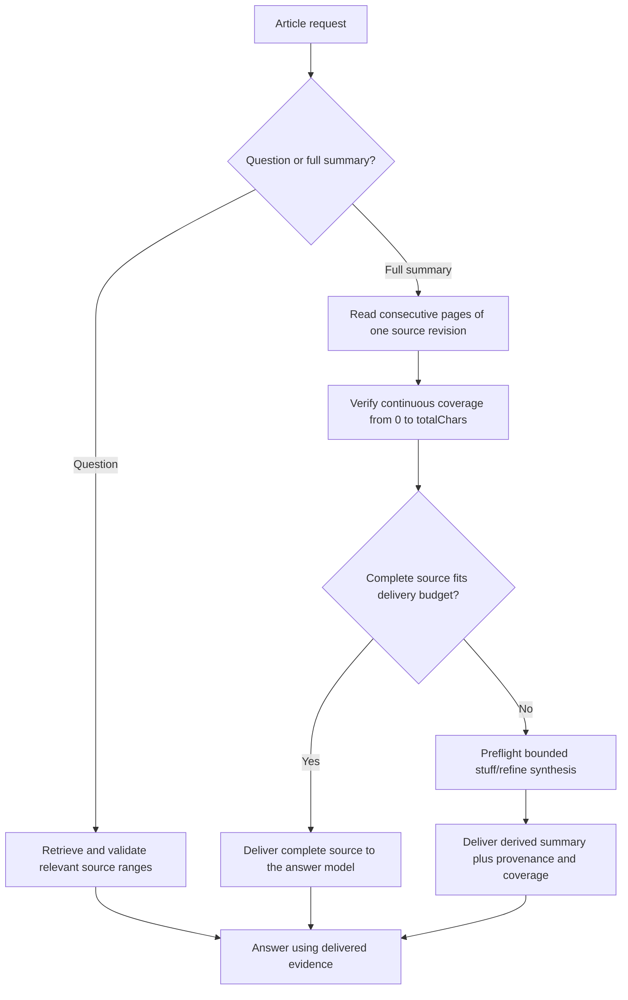

# Context, budgets, and article evidence

[Guide](README.md) · [中文：会话与记忆](../conversation-memory.md) · [中文：RAG](../rag-design.md)

## Build the complete request

The model's context window is not an appropriate target size for every request. Admission accounts for the system instructions, retained messages, current page/task observations, all visible tool schemas, tool-call envelopes and results, and reserved output. Task limits separately bound cumulative tokens, model calls, tool calls, and active execution time.

Provider retries, conversation compaction, internal article synthesis, and resumed execution consume the same task allowance. Usage is reserved before a call and settled against actual provider usage when available. An unknown outcome retains its reservation. A new HTTP request must not charge the historical total a second time.

The framework estimates tokens for admission; this is not an exact provider bill. Set `AGENT_CONTEXT_TOKENS` to the actual endpoint capacity. Current defaults and validation belong to [configuration](../configuration.md) and [the settings source](../../config/settings.py).

## Keep a bounded tool working set

The model starts with basic article/browser capabilities and domain discovery. Discovery is projected from the caller's authorized catalog. Heavier domains load on demand and keep a stable order across turns and checkpoint recovery.

A soft schema working-set target limits inherited idle domains. Capacity handling protects the active batch and retains discovery; released domains can be loaded again. History growth alone is not a reason to repeatedly unload tools. Every actual call still checks authorization.

When old complete turns require compaction, the summary remains source-marked data, not a system instruction or a new user utterance. The host's original conversation remains distinct from the runtime's compacted view. Unknown source identity cannot be relabeled as the current user. The system does not automatically extract cross-conversation long-term preferences.

## Retrieval is evidence selection

Only public articles enter the article corpus. Private/admin data, announcements, and personal data use their own tools. Corpus import validates pages, revisions, hashes, ordering, totals, and cursors before atomically replacing a complete index. A stale complete snapshot and an unavailable index are different states.

Markdown parsing retains source coordinates; section-aware splitting uses LangChain's splitter. BM25S supplies lexical ranking with Chinese/English tokenization. Optional hybrid retrieval uses embeddings and PostgreSQL/pgvector exact search. LangChain's reciprocal rank fusion combines rank order, not confidence probabilities. The current system does not add a query-rewrite LLM or cross-encoder reranker.

One article can retain several distinct matching ranges, including multiple hits in one section. Candidates are not automatically evidence: current public visibility and source hashes must be verified. Only exact validated text ranges establish what the answer model has read.

Evidence presentation shares the next model request's available input across pending article tools. It reserves readable text rather than allowing many locators to crowd the body down to a few characters. Omitted locations are reported; clipping adjusts exact coordinates. A partial section is not a whole section, and a retrieved excerpt is not the whole article.

## Full-document summaries use a separate path

HTTP pagination does not imply the model sees isolated pages. The summary tool validates revision, parser schema, offsets, lengths, continuation, and completion, then joins pages without inserted separators. If that complete source fits the current delivery allowance, it goes directly to the main model with no internal synthesis call.

Otherwise, a bounded LangChain stuff/refine workflow processes the source. The tool preflights the internal plan and temporarily reserves capacity for the main model's final answer. Provenance and coverage metadata are included before choosing summary output capacity. The reservation is not consumed usage and is released on exit.

Source changes, missing ranges, insufficient capacity, cancellation, truncated output, or an oversized serialized result prevent a partial result being delivered as a complete summary. A derived summary records source coverage separately; it does not claim the main model directly read the full original. Complete processing still cannot guarantee semantic fidelity: later sections and cross-section qualifications require evaluation.

## Implementation and checks

- [Observation planning](../../agent/runtime/tool_context.py), [task budget](../../agent/runtime/budget.py), and [output budget](../../agent/runtime/output_budget.py).
- [Summary source validation](../../agent/domains/articles/summary.py), [synthesis](../../agent/domains/articles/summary_model.py), and [article middleware](../../agent/products/blog/articles.py).
- [Retrieval ranking](../../rag/ranking.py), [passage presentation](../../rag/passages.py), and [reading](../../rag/reading.py).
- [Observation-plan tests](../../tests/runtime/test_observation_plan.py), [full-summary tests](../../tests/test_article_full_summary.py), and [retrieval-evidence tests](../../tests/test_retrieval_candidate_evidence.py).

The [full-document engineering case](engineering-cases.md#1-full-document-summaries-under-a-real-request-budget) explains the failure this boundary prevents. Hybrid benefit, caching, and cost need measurements on the selected provider and corpus; their presence is not a performance claim.
