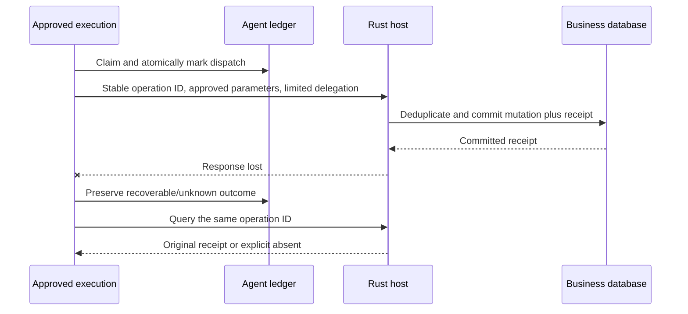

# Identity, approval, and recovery

[Guide](README.md) · [中文：身份与写入](../identity-and-permissions.md)

## Trust comes from the host

The Rust host validates the login session and signs a short-lived service assertion. The Agent verifies it and builds a principal. Tool access comes from deterministic role/scope checks at discovery, invocation, and approved execution. Messages, page text, memories, and model output cannot grant permissions.

The Agent does not hold the host's login JWT signing secret, tool-delegation signing secret, or device signing secret. It forwards host-issued limited tool delegation; the host rechecks the account's current role, token generation, and frozen status. Demoting an administrator does not require rotating a site-wide signing key to revoke that administrator's effective privileges.

## A proposal is not execution

Read tools can identify a target and its version. Preparation freezes the proposed operation and returns an approval card bound to the caller, conversation, operation, expiry, and target snapshot. Closing a UI card is not server-side cancellation. Revised proposals invalidate prior approval credentials.

Approval enters a controlled code path. It validates the signed bindings and current conditions again before dispatching a registered executor. The model cannot call a raw write merely because it discovered the preparation tool, nor can its prose mark a write as successful.

## Two records solve different problems

| Layer | Guarantee and limit |
| --- | --- |
| Agent execution ledger | Coordinates concurrent approvals, dispatch ownership, cancellation, recovery, and cached outcomes. It cannot atomically commit a remote business change. |
| Host business receipt | For supported operations, commits the unique operation ID, business mutation, and receipt in one PostgreSQL transaction. It cannot substitute for approval or current authorization. |

The ledger key comes from signed caller/conversation/operation coordinates plus the tool and arguments. Repeating the same approval uses the same key; a newly prepared and approved operation is a different operation even if its text is identical. Database uniqueness and atomic state transitions select the dispatcher, so concurrent attempts to create the ledger record do not each gain dispatch rights.

`claimed` has not crossed the tool-call boundary. `dispatched` may have crossed it and does not prove success or safe replay. `done` caches a tool result; a business-success claim still needs a valid receipt. Cancellation before dispatch is recorded, while an ambiguous remote result remains unknown.

## Recover a lost announcement response

Immediate single-announcement create/update/delete supports this recovery protocol. A matching receipt proves the original operation's outcome. An explicit `absent` result can permit submitting the same approved request to the same idempotent endpoint while approval remains valid; `absent` itself does not prove the first request never ran. The host's transaction and unique constraint provide the deduplication.

A failed lookup, unsupported old endpoint, changed request, invalid approval, or legacy unknown record cannot authorize replay. Other writes remain conservative unless they implement their own safe business recovery. This is not a distributed exactly-once guarantee.

## Browser and editor actions

Sending a browser command proves only that it was sent. Completed, failed, timeout, and unknown feedback have distinct meanings. Editor content changes require review/adoption; persistence and publishing still use host version checks and normal business flows. Generated-image execution and saving the reviewed result are separate approval decisions.

## Implementation and checks

- [Identity and scopes](../../agent/authz.py), [principal](../../agent/principal.py), and [domain registry](../../agent/domains/registry.py).
- [Execution handling](../../agent/runtime/writes.py), [announcement recovery](../../agent/domains/announcements/recovery.py), and [transaction adapter](../../agent/domains/announcements/transactions.py).
- [Ledger regression tests](../../tests/runtime/test_write_ledger_contracts.py) and [native announcement tests](../../tests/domains/test_announcements_native.py).

The [write-recovery case](engineering-cases.md#2-a-write-succeeds-but-its-response-is-lost) connects these boundaries to the concrete retry failure. Business endpoint details belong to the [host's security contract](https://github.com/BigLeopardCat/Saudade-Blog/blob/main/docs/security-boundary.md).
