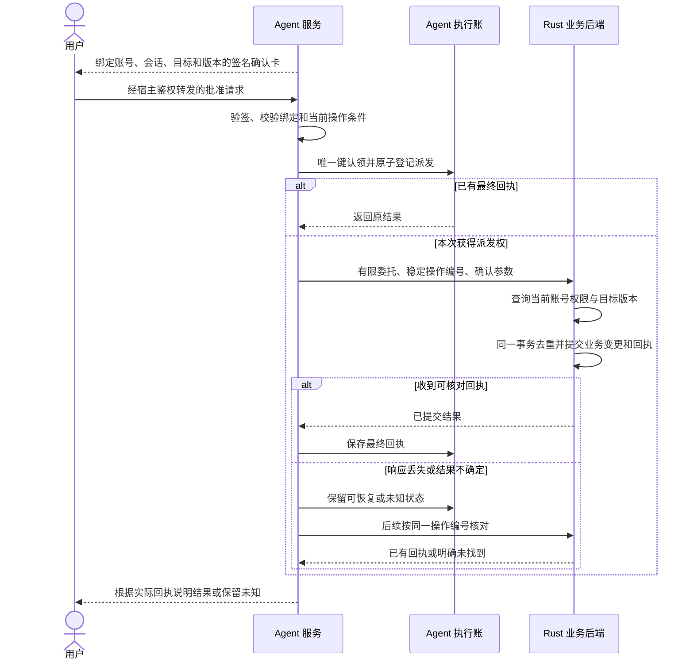

# 身份、权限与写入确认

## 身份来源

Rust 宿主验证登录态后生成短期签名断言，Agent 验签后构造 Principal。用户在聊天里声称自己是管理员、页面文本或历史摘要均不能提升权限。缺少或无效身份断言一律拒绝，不提供关闭校验的开关；`AGENT_ASSERTION_SECRET` 只校验服务身份；`AGENT_CONFIRM_SECRET` 独立签署确认卡。Agent 不持有博客的 `JWT_SECRET`、`BLOG_DELEGATION_SECRET` 或设备的签名密钥。

工具调用转发宿主签发的 `aud=blog-tools` 委托，绑定 uid 与 token_version，有效期五分钟。宿主重新查询冻结状态、令牌代次和当前角色；委托不能登录、修改密码、创建新委托或进入聊天代理。后台任务使用最长三十天的有限授权，允许白名单读取、搜索、向本人投递结果及通过专用端点执行已批准的版本绑定变更；管理员再次发起真实聊天或访问已认证任务面板会续期，过期须重新认证。授权保存在 `DELEGATION_DIR` 的 0700 目录及 0600 文件中，不进入模型上下文、Principal 或 trace。

在线评测使用 `SAUDADE_OPERATOR_SESSIONS_FILE` 指向 0600 的 JSON 文件（用户 ID 字符串映射到真实登录 token），由宿主交换短期委托；不再自签登录态。该文件只交给操作员的探针进程，不配置到生产 Agent。使用旧工具适配器的独立只读探针可将宿主交换得到的五分钟委托写入同样 0600 的 `SAUDADE_OPERATOR_TOOLS_FILE`（uid → token）；没有显式授权会失败关闭。

会话清理由 Rust 在属主校验和事务入队后签发 `aud=agent-checkpoint` 的 60 秒授权，绑定用户、会话、删除操作及可选的轮次标识。Agent 拒绝普通聊天断言、目标篡改和过期授权；清理重试重新签发授权，不依赖已删除的博客会话行。

角色与 scope 控制能力：工具目录发现、每次调用以及批准执行分别检查。准备工具只读取目标、冻结提议并返回卡片；真实写工具只允许受控执行路径调用。可见目录不能代替执行授权。

## 写入生命周期

1. 模型查询必要目标与当前版本，准备明确的操作参数。
2. 确认卡展示影响范围、目标和待提交内容，令牌绑定账号、会话、操作、有效期及目标快照。
3. 用户批准后，服务端再次验证身份、签名、版本和业务条件。
4. 先以唯一键认领执行账，再原子登记派发状态并调用后端；返回已知回执，或保留可核对的未知状态。
5. 模型基于真实回执叙述。叙述失败只影响表达，不重做写入。

关闭 UI 卡片不等于撤销。服务端取消会撤销旧签名并保存未执行事实。审批期间的新要求撤销旧提议，再由同一 Agent 按反馈继续，不能让旧卡仍可执行。

## 确认与业务回执时序

以下以支持操作编号恢复的公告写入为例。模型只准备提议，批准后的副作用由确定性代码执行。

“先入账”不会自动使远端副作用幂等。执行账协调 Agent 内部的并发、取消和恢复，
业务事务负责副作用与业务回执的一致性；两边不能当成一个跨服务事务。
不支持安全恢复的工具必须保持未知并人工核对，不能照此图推导出任意写操作都可以重试。
管理员降权依赖当前角色/令牌代次的后端复核，不要求更换全站签名密钥。

## 批量操作

同类同事务目标可以在一张卡中逐项选择、全选或取消；不同事务可以有多张卡。选择集合在签名允许的目标中取子集，不能注入新对象。执行结果逐项记录，部分失败不能描述成全部成功。

## 浏览器与编辑器

发送客户端命令只表示已发送。导航、显示设置、协作编辑必须等待有界回报，分别处理 completed、failed、timeout 和 unknown。客户端回报不授予账号权限，也不是业务数据库已保存的证明。

协作正文、标题通过编辑器审阅采纳；文章摘要使用聊天确认卡。发布复用宿主发布流程，不因 Agent 看到编辑页而绕过保存和版本检查。

AI 生图需两次独立决定：先批准确切模型、提示词、参数和参考图，随后审阅真实结果再决定入库。选为文章封面属于独立修改。API 密钥、确认凭据和私有图片数据不得进入公开正文或 trace。

## 隔离与重试

执行账防重复并管理未知结果，不承诺跨服务 exactly-once。远端成功但本地未保存回执时，先查询或人工核实。目标版本变化需要重新准备；其他账号、会话、已取消或已过期令牌拒绝执行。

执行账主键由已签名的账号、会话、确认操作标识、工具及参数计算。同一批准重试沿用原键；
重新准备并批准属于新操作，不能仅因文字相同去重。`claimed` 表示尚未跨过工具调用边界，
一个原子更新选出派发者；`dispatched` 表示可能已调用，不能推断已经成功或安全重试。
观察到发出前取消时保存 `cancelled`；`done` 缓存工具返回结果，业务成功仍须有效回执证明。
旧 `intent` 保留未知语义。

即时单项公告创建、修改和删除使用 `recoverable`：在调用前登记稳定操作编号，通过宿主
`announcement-operations` 接口将编号去重、公告、个人通知和回执放在同一 PostgreSQL 事务。
响应丢失后只读核对一次；接续先查询原编号，只有明确返回 `absent` 且原批准仍有效时，
才允许向同一幂等入口再次提交相同请求。`absent` 不证明未执行，安全性来自业务事务唯一约束。
相同编号绑定不同参数拒绝；查询失败、旧宿主 404 或旧执行账未知记录都不能触发写入重试。
其他写工具仍保守处理未知结果，不宣称已具备业务端幂等。

管理员可通过公告域的 `get_announcement_operation` 只读查询本人历史回执。
历史成功不代表公告现在仍存在，回执不自动撤销审批，也不授予重试权限。
先迁移并发布宿主接口，再升级 Agent；回滚时保留两端账目，不清账、不将新状态改回 `intent`。
旧执行器不能识别新状态时应拒绝继续执行，待升级后核对。

回归应覆盖真实 ToolNode/middleware 接线、全工具目录准入、跨账号拒绝、重复批准、取消、目标冲突和未知结果，不能只单测准备函数返回了卡片。

### 生图卡片修改

生图准备仅冻结请求和参考图，不调用计费 API。卡片中的提示词、模型、尺寸和质量可编辑；
点击“更新预览”后，宿主按当前登录身份和会话转发，服务端校验允许列表并创建新请求版本，
撤销旧确认凭据，再通过 LangGraph 原生 checkpoint 更新待确认状态。修改过程不调用模型。
未保存的草稿不能批准，实际生成与结果入库仍分别确认。

图库 ID 与聊天图片引用是不同类型。聊天参考图仅从当前用户、当前会话及当前角色的上传记录解析，
服务端冻结原始字节及摘要；引用不接受外部 URL，也不把图片内容搬进工具参数。
