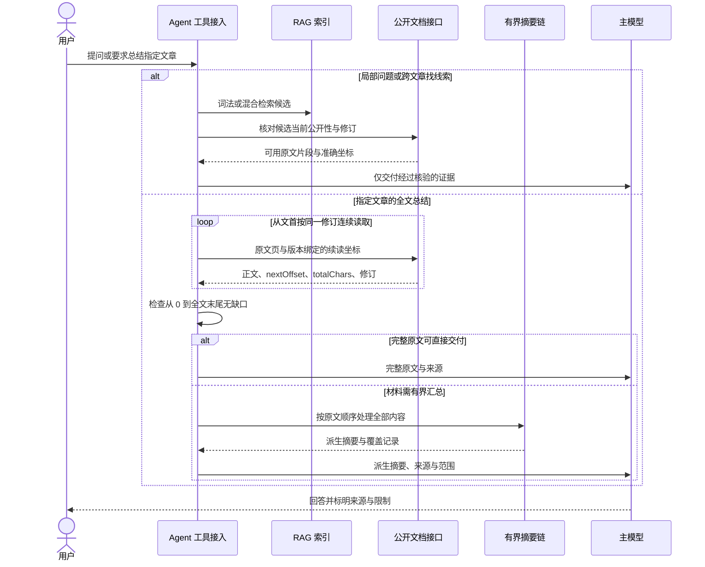

# RAG 文章检索与证据读取

当前契约由版本化语料快照、结构感知检索、正文范围读取和证据检查组成。
组件边界见 [架构说明](agent-architecture.md)。

## 1. 数据与权限边界

检索池只收公开文章。留言、说说、公告、本人数据与后台数据使用各自工具。
宿主的 public_condition 同时约束公开状态、is_public 和非修改稿；
Agent 不持有后台凭据扩充语料。检索结果经宿主批量核验当前公开状态与正文 hash；
仅同版本快照中的精确原文范围可作为正文证据。直接读取仍由公开详情接口核验。
首页向量词图是另一条展示/搜索链路，不是回答阶段的正文证据。

## 2. 版本化语料协议

GET /api/public/rag/corpus 接受 limit、after、revision。
首请求不带游标，后续请求携带 next_cursor 和同一 revision。

| 成功信封 data 字段 | 含义 |
|---|---|
| schema_version | 协议版本 |
| revision | 整个公开语料集合的内容指纹 |
| total | 同版本的文章总数 |
| documents | 每篇 id、title、content、revision |
| next_cursor | 下一页游标；末页为 null |

每页在 PostgreSQL repeatable-read、read-only 事务中取得页和摘要。
指纹覆盖公开集合成员、标题及正文，不依赖写方更新 updated_at。
分页期间内容或可见性变化返回 HTTP 409，数据库故障返回 HTTP 503，
不能将故障包装成成功空列表。接口不增加阅读量、不返回作者内部身份。

rag/corpus.py 校验版本、内容摘要、总数、严格递增 ID、页大小和游标。
完整且同版本的全部页面才能提交索引。没有旧列表接口的隐式回落：
先部署宿主新增接口，再部署 Agent。

## 3. 刷新与陈旧数据

RagIndex 使用单次构建锁，在短锁内替换完整视图。冷启动同步构建；快照超过10分钟但仍在
20分钟宽限期内时，每个索引最多调度一次后台刷新，检索继续使用完整旧快照。
空闲超过宽限期后的首个查询按冷启动方式刷新，再判断是否可用，避免健康源也触发无谓回退读取。
刷新失败保留上次成功版本并退避30秒；超出宽限期且刷新失败或仍在构建时返回 unavailable，
正常空语料返回 empty。
启动预热、版本失效和查询刷新共用同一调度入口。周期与窗口以 rag/search.py 为准。工具 meta 记录版本、最近成功时间、stale 和错误；
候选文本也标注使用了旧完整索引。

正文读取仍实时核对公开可见性；索引标题元数据有刷新窗口，不声称即时撤回。
读取反馈的版本不匹配会使相关缓存失效，构建期间的失效信号也不能丢失。

## 4. 切片与词法检索

rag/sections.py 使用 markdown-it-py 的 CommonMark block token 与 source line map，
识别顶层 ATX/Setext 标题；围栏、缩进代码和 HTML 中的类标题，以及引用/列表内局部标题，
均留在所在正文中。应用只维护分节树、空父标题、层级路径和读取视图版本内的小节 ID。
正文和后代范围直接切原始字符串，保留 CRLF/CR 和 Unicode，不经渲染文本找回偏移。
重复名称/编号不能默认取首个。

rag/chunks.py 使用 LangChain 的 RecursiveCharacterTextSplitter 在小节内切片，
按段落、行和中英文边界配置限制字符预算并保留重叠，
记录 chunk_id、section_id、标题路径和相对小节正文的范围。
词法与向量均使用文章标题、路径和正文，标题不再因跨过长度阈值而丢失。
字符预算是模型无关的输入上限，不宣称等于供应商的精确 token 数。
可选 embedding profile 只在向量侧细分超 token 预算的片段，完整计算标题、路径及
指令，保留小节源范围；配置损坏仍可走词法，见 [输入预算说明](embedding-inputs.md)。

词法使用 jieba 搜索分词、中文二字回退和 Snowball 英文词干，保留技术标识符与原文偏移；
查询优先内容词，全为停用词时保留原查询特征。`rag/lexical.py` 是 BM25S 的薄适配，
索引、词频统计、长度归一与评分交给锁定版本的库；参数来自 BM25_K1、BM25_B。
使用 Lucene 方法、float64 和 NumPy 后端，构建后只读，随完整语料快照原子替换。
状态与评测报告记录库版本和评分方法。原生分数不作为置信度；
原分只用于本路排序。最终 top_k 限于1至50；每路内部候选数为
`min(100, max(20, 3 * top_k))`，RRF 融合后再截取最终条数，降级路径也遵守输出上限。
两路共用 rag/ranking.py 聚合文档，每篇保留最多三个不同小节的最佳片段；
小节标题、ID及范围一起选取，避免同节重复命中挤掉其他小节的定位证据。
每个位置保留检索路的原始分数、标题/章节/正文词元匹配字段，
以及最多240字、带准确字符坐标的索引原文摘录；仅标题共现的背景片段不会标成正文匹配。
未核验的索引摘录只帮助选择位置，不登记正文已读；经公开性和 hash 核验后，
从快照解析出的精确原文片段才登记为局部正文证据。同一版本与位置融合时合并分数并保留摘录；
同一范围出现冲突原文则拒绝融合。
片段携带同版本源小节的 `section_chars`；只有从零开始且覆盖该长度才标为
`section_complete=true`。截取、预算裁剪或未知长度不能声称小节完整，也不代表全文已读。
查询保留原始问句；不删除疑问词、不按头部分数裁掉尾候选。
少量领域别名映射属于博客词表配置；候选与实际答案证据仍分开判断。
没有独立 LLM 查询重写器或 cross-encoder 重排模型；RRF 是名次融合。
新增改写或重排须用固定数据分别比较召回、排序、延迟和费用，不能用新调用数量代替收益。
默认候选数由 rag.DEFAULT_TOP_K 定义，工具与固定语料评测共用。

## 5. 向量与持久化

RAG_HYBRID_ENABLED 控制可选的向量融合；
只融合可用、与语料和空间一致的视图，故障明确退回词法并记录原因。

空间包含模型、端点、请求维度、分块策略与可选 profile 签名，内容键覆盖实际发送的
embedding 文本。查询 LRU 同时校验空间与实际维度；拒绝非有限值、零向量、错误批次
index 和不一致维度。未声明请求维度的模型若实际维度变化，必须重新构建完整视图。

持久化使用 PostgreSQL 的独立 `rag` schema；`RAG_VECTOR_DSN` 可以指向现有业务数据库，
`RAG_VECTOR_COLLECTION` 隔离不同公开语料。SQLAlchemy Core 管理有界连接池、事务和绑定
参数，官方 pgvector 类型负责向量编码与 `<=>` 余弦距离。运行时不自动建扩展或表；
显式初始化、授权和切换步骤见 [部署](deployment.md#向量存储)。

数据库保存内容向量、当前 corpus membership 和空间/指纹状态。embedding 在数据库事务外
完成；只嵌新增或变化的唯一输入。成功片段可缓存供失败重试，但只有完整覆盖的构建才能在
一个短事务中替换 membership、发布状态并清理集合内已删除/私密化及旧空间的向量。
发布与失败缓存清理使用同 collection 下 `(key, dimension)` 的无相关子查询集合差，
避免新集合批量写入后统计尚未更新时逐行扫描成员。成员表的外键列有联合 B-tree 索引，
避免删除旧向量时外键检查全表扫描；已有表通过显式 `setup` 补索引，运行查询不建表或索引。
数据库语句超时保持有界。
删除或私密化最后一篇文章时，同样发布 count=0、dimension=0 的完整空快照，并清空该集合
的membership与向量；构建和查询空集合均不调用embedding。事务异常保留原完整快照。session advisory lock 协调写方，在模型等待期间没有长事务；
读取以短 repeatable-read 事务核对语料指纹，不能将旧向量与新正文片段拼接。
正文与候选的公开性仍须由宿主实时复核，数据库快照不代替授权。
语料 revision 当前是内容 hash，不提供跨进程单调顺序；较早抓取但较晚提交的构建可能
暂时覆盖新 fingerprint。查询按当前词法指纹拒绝混用，回退 BM25 后重建，而不宣称 writer
互斥锁提供来源版本 fencing。彻底避免这段可用性回退需要宿主单调版本或提交前的轻量版本校验。

当前规模使用 pgvector exact search；数据库先计算片段余弦距离，按文章最佳片段聚合后
取文档 top_k，再返回这几篇的证据位置分数。不把片段 top_k 当成文章 top_k，不把全部
向量拉回 Python 算距离。不默认建立 ANN 索引；只有规模、延迟和过滤后召回实测需要时
才比较 HNSW/IVFFlat，并重新验证召回与证据覆盖。
成员到向量按外键对应的主键做标量点查，避免刚发布的新集合统计不足时关联查询被规划为
只按 collection 扫描的二次循环；所有余弦运算与文档聚合仍在数据库内完成。

每个进程的向量池默认最多4个连接、无 overflow，构造时拒绝少于2个连接（writer占一个、短事务需要另一个），获取连接等待与SQL有独立上限；一个构建者
会在模型等待期间占用一个 session-lock 连接，部署多 worker 时须计入数据库总预算。
向量库故障或未配置 DSN 明确降级 BM25。旧文件缓存不再参与读取；首次迁移要按公开语料
重新生成，先估算费用，原文件由维护者确认新索引验收后清理，不自动删除回滚材料。

RRF 排名交给 LangChain 官方 EnsembleRetriever.weighted_reciprocal_rank，
对文档、小节 ID 及同节范围分别按两路名次融合，不让词法先入的三个小节挤掉语义定位。
只合并同一来源版本和解析 schema，重复标题按小节 ID 区分；不复制评分算法。该公开接口只返回顺序，混合候选因此提供 rank，
不伪造 score；词法、向量单路的原生分仅用于各路排序和截断，工具出口统一显示排名。
langchain-classic 只提供此 retriever，不装配第二套运行时。
RRF 是相对排名，不是相关性置信度。启用前比较固定语料上的命中、噪声、证据获取、
回答支持度与延迟/成本；文章篇数不能单独证明收益。

## 检索与全文总结的选择

局部检索命中不证明全文覆盖。全文路径在读取版本变化、缺页、预算不足、取消或摘要失败时
明确未完成，不把已有局部材料冒充全文。覆盖校验只证明原文进入处理链，不证明模型摘要
语义忠实；有界汇总也不表示主模型在同一请求里看到了全部原始正文。实现细节见下一节。

## 6. 正文、小节和范围

已知文章内的局部问题可以用 `rag_search(article_id=...)` 获取经核验的正文片段；
片段充分时即可作答，不要求再读同一范围。需要更多上下文时使用返回的结构化
`read_requests` 仅列出尚未交付的检索范围；已交付片段保留章节路径，预算裁剪后重新计算剩余范围。
需要全文才顺序续读。文章限定在
BM25S 的文章段落语料和 PG 距离查询的 WHERE 中生效，先限定再取文档 top_k。
限定文章时，词频与平均段落长度仅按该文计算，避免全站语料影响文章内部的章节排序；
每个不可变词法快照使用标准 LRU 缓存最多 32 个限定索引，更新快照后不复用旧索引。
跨文章搜索仍按完整语料评分。检索文字按完整
候选条目缩页，结构化 evidence 只登记模型看见的候选；一个条目也放不下时返回 unavailable。
模型可见 JSON 与 evidence 使用同一批正文片段和完整坐标；文档级 source 共享版本与解析器，
每个片段仅保留相对范围，不重复长 hash。预算裁剪未呈现的片段不会登记已读。
索引刷新导致候选与快照版本不一致时返回 unavailable，不拼接不同版本的正文。
工具 schema 与检索入口共用 top_k 上限 50，越界输入在参数校验时拒绝。

`get_article_detail` 必须显式提供 `selection.kind`：`question` 携带 query，复用现有文章检索；
`summary` 用于公开文章的全文总结或整篇分析，可传递关注点和格式要求。代码从文首遍历
全部正文页，绑定同一内容版本与解析器，检查文档范围从 0 无缺口到 `totalChars`，
单页完整原文能放入当前工具结果及模型输入预算时，直接以 `view=body` 交给主模型作答，
不先调用另一模型生成中间摘要。多页或超出交付预算的材料使用现有 LangChain 文档摘要链：
能容纳时使用 stuff；超窗时用标准 RecursiveCharacterTextSplitter 按原文顺序无重叠分段，
再用 refine 将前段摘要与后续原文逐次合并。每个分段校验精确源坐标，保留空白，
不因正文分页切开句子而插入分隔。
内部模型调用不带业务工具、不向聊天流输出中间结果，沿用任务累计调用、Token、时间与取消边界；
额外正文页也计入工具预算。源版本变化、缺页、空正文、预算不足、模型输出截断或取消时，
不交付部分结果为完整总结。分段摘要仍可能遗漏细节，覆盖通过不等于语义正确。

直接交付的原文沿用正文范围证据，并携带可引用的文章链接。派生结果的 `view=summary`
标记派生文本、stuff/refine 策略、段数及完整源覆盖；
`document_summaries` 单独记录其来源，不登记为聊天模型直接看过的原文范围。
它在独立模型输入中处理正文，不依赖普通会话压缩保留全部分页；总结输出也须完整
放入工具结果预算，放不下则拒绝交付，不能截断后继续声称完整。模型仍负责选择总结模式，
提示词要求全文总结使用 summary，真实模型验收分别检查模式选择与内容忠实度。
已完整交付的摘要及其工具调用组保留至当前任务结束，后续查询触发通用会话压缩时
不再次压缩这份证据；新任务不继承该保护，材料仍须符合总上下文与累计预算。

原文阅读使用以下范围：
`full_text` 从文首读取原文，`source_range` 按已知小节或续读坐标读取。单页最多 32768 字符，使用 offset、max_chars、revision，
返回 contentRevision、readOffset、nextOffset、totalChars、readComplete、source 和小节 ID。
每种读取模式只公开实际支持的参数；全文不接受小节或偏移，目录偏移沿用返回的
nextSectionsOffset，元数据不接受正文选择。参数错误不撤销先前已验证的目录和续读坐标；
来源版本或读取状态失效时仍清除这些绑定。
同一原生工具交换内，相同版本、范围和内容只向模型交付一份正文，其余工具结果引用
该交换中先前的工具调用。保留全部调用 ID 和 checkpoint 原始结果，跨交换或版本不复用。
该视图在框架 middleware 中提供给预算与模型；追加新轮次不改写历史请求前缀。
来源链接和版本元数据位于正文之前，`article_context_reused` 记录复用范围及减少的输入字符。
工具将两种正文范围映射到宿主的 `view=body`；question 与 `rag_search(article_id=...)` 共用检索、版本验证和正文证据，
不因文章编号已知而默认取整篇。已绑定版本的来源范围可以从文档偏移 0 开始。
续读范围或按小节 ID 读取必须带版本，防止编辑后跨版本拼接。
同一任务顺序读取整篇正文时，文章中间件可从已呈现的可信范围补齐下一页缺失的
revision 与 section_schema，仅限同一文章、无小节选择且 offset 精确等于已返回的
nextOffset。显式冲突值不覆盖；读取失败清除对应游标，新任务不继承旧任务游标。
已显示的 RAG 读取坐标、目录中的小节及其 nextSectionsOffset 也可绑定相应版本。
同一文章的小节 ID 读取可复用任务内唯一已核验的文档版本；这不登记该节已读或证明坐标存在。
不猜测正文或目录续页游标；多个来源版本冲突时不自动绑定。宿主仍校验坐标、公开性与版本，正文修改后返回冲突。
独立小节可由模型在同一轮发出多个原生工具调用，不需要另一套读取规划器。
按标题/编号只接受唯一匹配；selectedScope 明确区分 document 与 section_subtree，
父节读取包括子节，readComplete 只描述该选定范围。
contentRevision 与语料传输使用相同的标题、原文 canonical hash；解析器身份单独由
sectionSchema 传递。检索候选 document_revision 使用相同内容版本，客户端只需原样回传。
解析策略变化会明确拒绝旧 sN/续读版本；首次全文读取可取得当前版本与目录。

`selection.kind=metadata` 只返回已存在的公开元信息（作者、摘要及展示字段），不返回正文、目录数量
或正文读取凭证；不能据此总结正文。已知编号可直接读取，无需检索定位，缺失字段保持未知。

`selection.kind=outline` 仅分页读取目录，不登记正文已读。每页最多 12 项，offset 是目录条目下标，
从 nextSectionsOffset 续页；正文的 offset 则从 nextOffset 续读。两类续页都须回传
contentRevision 与 sectionSchema。sectionsOffset、sectionCount 和 nextSectionsOffset
使长文完整目录可遍历；预算不足时仅缩短完整目录项并同步续页，不截断定位 JSON。

无结构文章和超长单节也能连续读到尾部。偏移以选定正文为准，
切片记录与按节读取一致。预算渲染保持可解析数据，并把 nextOffset/source.end
调整到模型实际看到的正文末尾；剩余预算不足时不登记正文证据。

## 7. 运行时证据规则

文章能力运行于现有 LangChain Agent，通过
[ArticleMiddleware](../agent/products/blog/articles.py) 的公开 middleware hooks 观察工具结果、
处理最终回复，并在恢复时读取已保存的证据快照。工具选择与普通原文续读由 Agent 决定；
summary 模式的完整正文遍历与汇总由代码负责。

[ArticleEvidence](../agent/domains/articles/evidence.py) 分别记录公开搜索候选、
模型实际可见的非空正文范围，以及已读正文提到的文章链接。正文先按本轮预算渲染，
再登记可见字符、revision、小节及范围；到达选定范围末尾不等于读完全文。
候选与其中的真实链接可用于文章推荐。经核验的可见原文片段登记为局部正文读取，
未核验的索引摘录不登记；局部证据不证明看过整篇，也不支持任意正文结论。

全文总结成功或失败随同任务证据保存；失败后不允许用先前片段替代完整总结。
派生摘要和完整源覆盖在 `document_summaries` 中单列，不据此声称聊天模型直接读过原文。
最终回复的站内文章引用必须来自已知候选、已读文章、完整总结来源或已读正文提到的本站链接；
未知文章及错误站点引用会被阻止。成功读取正文后，若回复遗漏相应来源，
中间件追加真实已读文章链接。RAG 搜索的 empty 与服务 failed 分别记录，
无可核实结果时使用不同说明。

这些检查验证链接出处和读取范围。内容相关性、结论支持度、忠实度及提示词注入风险
仍由语义评测与端到端验收判断，不能从候选分数、链接合法或成功读取推导答案正确。

## 8. 评测与验收

确定性回归覆盖分页故障/版本变化、空语料、标题独有词、长度统计、并发构建、
重复小节、无缺口范围续读、缓存每阶段中断、同长损坏、空间切换和候选直答。

报告携带整库及逐篇内容摘要、查询/标注摘要、切片版本、检索配置、embedding 空间摘要
和检索代码摘要。同 ID/篇数不代表相同语料。历史 recall@k 字段表示至少一个正确文档
进入前 k，应按 Hit@k 解读，不作为多文档完整覆盖率。live 评测用于运维，固定语料用于回归。

运行 python -m pytest tests/test_rag_contracts.py tests/test_rag_evidence.py。
宿主包含 rag_corpus 单元测试和 TEST_PG_URL 指向的一次性 PG 集成测试。
真实回答质量与 embedding 收益需要真实模型凭据，不能用桩结果冒充。

固定离线检索评测及外部模型对照入口见 [固定语料评测](../eval/offline-rag.md)。

## 9. 设计依据

- [Lucene BM25Similarity](https://lucene.apache.org/core/9_9_0/core/org/apache/lucene/search/similarities/BM25Similarity.html)：平均长度采用总词频/文档数。
- [Azure RAG chunking](https://learn.microsoft.com/en-us/azure/architecture/ai-ml/guide/rag/rag-chunking-phase)：按结构和预算切分并验证效果。
