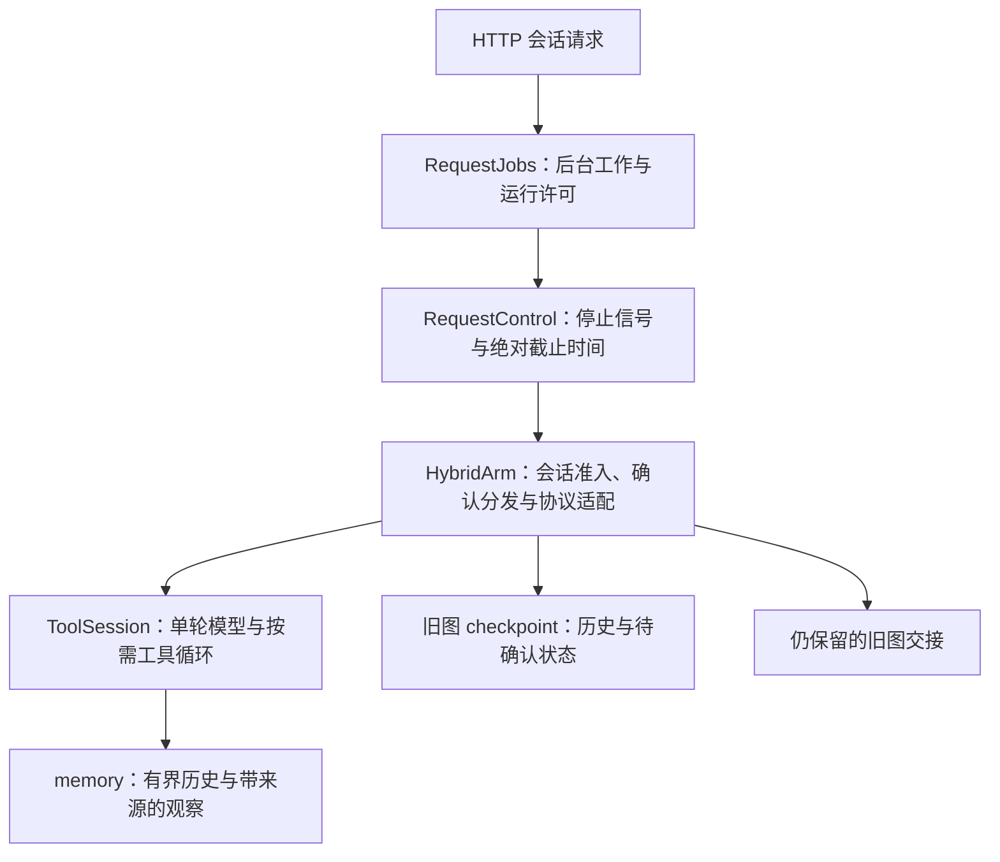

# 会话运行时审查与收敛顺序

审查基线：Agent `30aa0a1`，参考独立报告快照 `3a49d5d`。
独立报告的资源准入、跨引擎预算、完整请求计量、存储耦合和缓冲输出判断仍成立。
其中“剩余知识库、设备与管理员工具待迁移”已过时：现有 69 件业务工具均有原生路径，
空置知识库工具另行退役。覆盖数量不代表真实模型任务质量或重构整体完成。

## 当前职责

`ToolSession` 是单轮执行上下文，不能与跨请求的 conversation 或长期用户记忆混为一谈。
其工具集合、计数、观察及文章证据每轮新建；历史来源工具可触发领域恢复。
跨请求状态由当前 checkpoint 保存。摘要是可能过时的数据，不是授权或执行凭据。
确认执行使用独立签名、撤销记录与持久执行账，未知结果不自动重做。

框架的 checkpointer 与 store 分别面向单线程短期状态与跨线程长期数据；
目前无需为了审查另建通用记忆平台或更换框架。
参见 [LangGraph 持久化](https://docs.langchain.com/oss/python/langgraph/persistence)。
按需加载工具的方向合理，参见 [Anthropic 工具加载实践](https://www.anthropic.com/research/advanced-tool-use)。

## 本批修复：后台任务准入与截止时间

- `/chat` 与 `/chat/stream` 共用每 worker 的有界准入许可。
- 一个请求的主生产者和可选摘要均登记实际 executor Future。
- 消费者离开即设置停止信号，取消尚未开始的工作；已经运行的同步调用自然结束前继续占许可。
- 所有相关工作退出且消费者结束后恰好归还一次许可；不阻塞事件循环等待线程。
- 相同请求的主执行与摘要共用单调时钟绝对截止时间，覆盖排队和引擎切换。
- 模型工厂压缩 SDK timeout，关闭该请求内 SDK 自动重试；原生循环每次调用重新计算剩余 timeout。
- 原生检查点及旧图的停止检查都检查该请求时限，断连后不能继续发起下一操作。
- trace 在后台工作完成后收尾，保留迟到的 usage 和资源释放事件：
  `runtime.consumer_closed` 记录仍运行/排队任务，`runtime.jobs_drained` 记录总耗时及断连后存活时长。

这是协作式取消。同步 HTTP 调用不能被杀线程终止；SDK timeout 也不代表服务商立即停止计算或计费。
尚未改为真正可取消的异步模型请求。许可是每 worker 的请求工作组限额，不是跨进程全局连接池。
普通读取仍按整轮保存，不承诺每个只读步骤都可从崩溃点恢复；业务写入依靠独立执行账恢复。

## 仍需完成

| 项目 | 已核对的现状 | 下一步 |
| --- | --- | --- |
| 跨引擎预算和读取上下文 | 时限已共享；交接仍丢失原生调用计数与观察 | 在退役旧路径时收敛；过渡期禁止用交接绕过预算 |
| 完整模型请求计量 | 24,000 限制只数消息 content 字符 | 统一计入工具定义、调用参数及输出预留，使用现有 token 估算器与实际 usage |
| 身份语义 | `_input` 把所有管理员都称为博客作者；授权角色并不能证明作者身份 | 从站点事实区分作者与管理员，角色仅用于授权 |
| 工具集合生命周期 | 历史来源会恢复整个领域，集合随历史变化 | 明确恢复与卸载策略，保留合法调用/结果配对，并测量菜单规模与缓存 |
| 循环预算 | 固定 4 轮，领域加载也消耗一轮 | 区分模型调用、工具尝试与时间预算，验证多领域任务，保留安全上限 |
| 会话存储 | `_finish` 仍用 graph_input 和 as_node=gate | 提取薄 ConversationStore，逐步移除旧图状态协议 |
| 输出事件 | 最终回复生成完才包装为一个 chunk | 先统一结构化阶段事件，再实现最终回复流式 |
| 验收与默认值 | 确认链路已有生产验收，模型意图与成本未系统比较；默认仍 graph | 固定请求级真实模型评测，再切默认并删除旧模板与纠偏 |

上述表格是当前状态；迁移文档各批次的测试数字是当时的验收记录。
历史记录不作为当前未迁移清单。无需逐步持久化每次纯读取，也不增加语义关键词路由。

## 工具定义规模观测

2026-10-24 使用当前注册工具和已验签管理员配置，无网络调用：
初始菜单 23 个定义，紧凑 JSON 为 7,220 字符；全部领域加载后 61 个定义，为 29,861 字符。
定义数量包含加载与准备入口，口径不同于 69 件业务工具覆盖数。
这些是字符计量，不能当 token 数；全加载是规模探针，不表示每次生产请求都会加载全部领域。
结果证明消息 content 限制漏算工具定义，未证明生产请求已超过模型窗口。

## 验证结果

本批完整离线回归 1114 passed、2 skipped；包含后台阻塞时断连不归还许可、排队任务取消、
两任务共同归还、提交失败恢复、剩余时限传递、SDK 重试设置以及真实 SSE 迭代器关闭边界。
既有错误帧测试改为在测试事件循环内等待假生产者退出，避免将后台线程留给下一项测试。
类型、lint、异常捕获、安全和词表门禁通过，未放宽阈值；server 模块行数上限由 2686 收紧至 2670。
